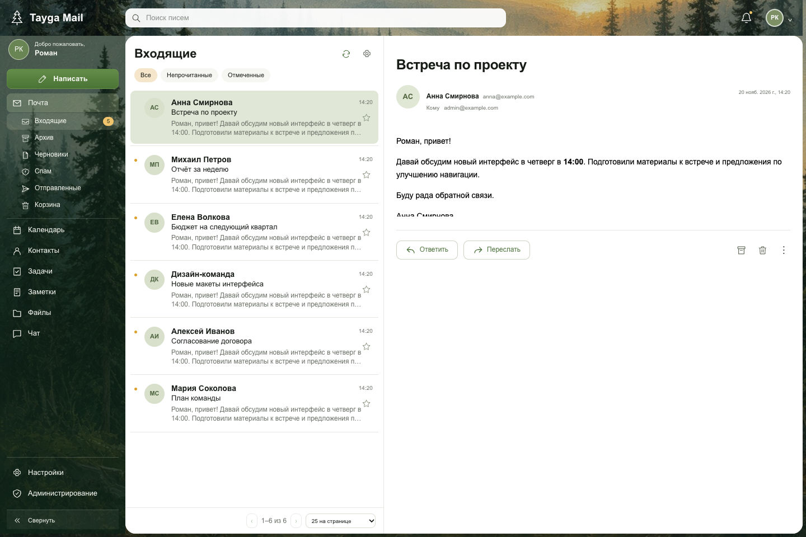
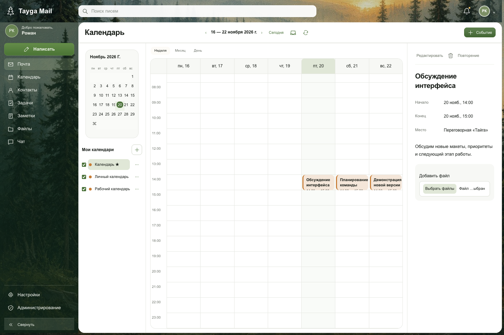
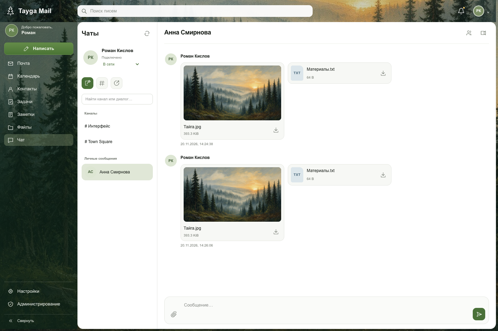
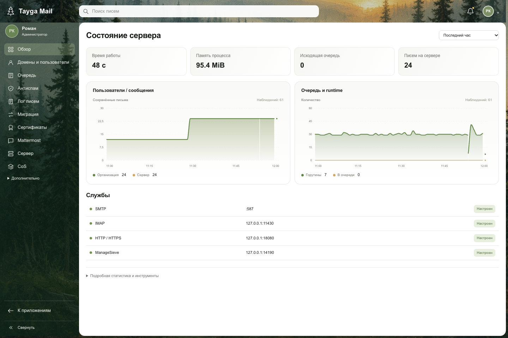

# Tayga Mail Server

**Mail and teamwork on your own server.**

[Русский](README.md) · **English**
[Download v1.2.0](https://github.com/rkislov/tayga-mail-server/releases/tag/v1.2.0) · [Setup](docs/setup.md) · [User guide](docs/user-guide.md) · [Administrator guide](docs/admin-guide.md) · [Screenshots](docs/screenshots/README.md)

Tayga Mail Server is an open-source mail and collaboration server. It brings email, calendars, contacts, tasks, notes, files and chat into one web workspace. Organizations run it on their own infrastructure and manage their domains, accounts, permissions and data storage.



## Why Tayga

- **Control over your data.** Choose where the server runs, how data is stored, who can access it and how it is backed up.
- **A shared workspace for everyday work.** Move between email, meetings, documents and conversations from one navigation menu.
- **A calm interface without advertising.** Light panels, soft green accents, artwork by Alisa Kislova, appearance settings and a sidebar that collapses to icons. The interface supports Russian and English.
- **Familiar email clients.** Standard SMTP, IMAP, POP3 and DAV protocols, with FlowSync for supported ActiveSync and EWS workflows.
- **Multiple organizations in one installation.** Central management of organizations, domains, users, quotas and administrative roles.
- **Open code and straightforward deployment.** Written in Go, with the web interface embedded in the executable. Choose SQLite or PostgreSQL and connect additional services as needed.

## Features

### Email

Folders, search, HTML messages, attachments, drafts, signatures, flags and bulk actions. The inbox shows 25 messages per page by default. Mail rules and automatic replies help manage incoming messages; delegation grants separate permissions for mailbox access.

Server features include SMTP/Submission/SMTPS, IMAP/IMAPS, POP3/POP3S, ManageSieve, domain and mailbox aliases, distribution groups, quotas, archiving, delivery retries and non-delivery notifications. External mailboxes can be collected over IMAP or POP3.

[Aliases](docs/mail-aliases.md) · [Rules](docs/setup-filters.md) · [External mailboxes](docs/external-mail.md) · [Archive and search](docs/mail-archive-search.md)

### Calendars, contacts, tasks and notes

Day, week and month views, invitations, recurring meetings and external calendar subscriptions. Contacts and the organization directory help people find colleagues. Tasks and notes keep plans, text and attachments alongside email. CalDAV and CardDAV connect compatible applications.



[Scheduling and invitations](docs/calendar-scheduling.md) · [Organization directory](docs/organization-directory.md)

### Files and documents

Personal files and shared spaces, folders, search, version history, trash, permissions and sharing links. WebDAV provides access from compatible clients. View images and PDFs in the browser; connect an external Collabora Online, ONLYOFFICE or R7 server to edit office documents.

[Files and office integrations](docs/files-and-office.md)

### Chat and meetings

A built-in Mattermost-compatible service provides direct messages, public and private channels, search and attachments. Web chat includes avatars, presence statuses, image previews and file-format icons. Jitsi connects conversations to video meetings and requires a separately configured Jitsi Meet service.



[Mattermost compatibility](docs/mattermost-compatibility.md) · [Bot setup](docs/mattermost-bots.md) · [Video meetings](docs/vks.md)

### Boards and Playbooks — experimental

Original Boards and the Tayga Playbooks community fork run as separately installed modules. Each tenant/domain and product receives its own PostgreSQL database/login, files and settings. Boards/cards and playbook/run creation, task completion and run finish were validated without a paid license or development mode. Advanced automations, attachments and mobile UX still need acceptance. Modules are installed and enabled separately.

[Setup and limitations](docs/mattermost-products.md) · [Playbooks fork and builds](https://github.com/rkislov/tms-playbooks/releases/tag/v2.9.7-tms.1)

### Mail protection and sign-in

SPF, DKIM, DMARC and ARC, TLS, delivery policies, rate limits and quarantine. Connect Rspamd for spam analysis and ClamAV or another supported scanner for antivirus checks. Administrators configure how the server handles each result.

Sign-in options include TOTP, WebAuthn passkeys, LDAP and OIDC integrations. WebAuthn protects web sign-in; mail-client access is governed separately. The web console also manages certificates, including ACME issuance.

[Protection and access settings](docs/admin-guide.md) · [Certificates](docs/ca.md)

### Administration

The web console brings together organizations, domains, users, classes of service, server settings, monitoring and certificates. The outbound queue and delivery log help investigate delays and failures; message details show related events and available SMTP replies.

Operational features include Prometheus metrics, data migration and encrypted full backups with verification and restore. High-availability guides describe one active Tayga instance, failover management and shared or replicated state.



[Delivery logs](docs/mail-delivery-logs.md) · [Migration](docs/migration.md) · [Full backups](docs/backup-full.md) · [High availability](docs/ha.md)

## Compatibility and integrations

- **Mail applications:** SMTP, IMAP and POP3, with Autodiscover and Mozilla autoconfig for client setup.
- **Calendars, contacts and files:** CalDAV, CardDAV and WebDAV.
- **FlowSync:** an original implementation of a subset of ActiveSync and EWS. See the [compatibility document](docs/flowsync-compatibility.md) for supported operations and limitations; full Microsoft Exchange compatibility is not claimed.
- **Thunderbird:** the Tayga extension is included in the [release](https://github.com/rkislov/tayga-mail-server/releases/tag/v1.2.0), with a separate [guide](extensions/thunderbird-tayga/README.md).
- **Infrastructure:** LDAP/OIDC, Prometheus, optional S3/MinIO storage and external spam, antivirus, office-editing and video services.

Available integrations depend on configuration. Mattermost API and plugin support have [documented compatibility boundaries](docs/mattermost-plugins.md).

## Installation

1. Download the archive for your platform and its checksums from [GitHub Releases](https://github.com/rkislov/tayga-mail-server/releases/tag/v1.2.0).
2. Prepare your domain, DNS, TLS and data directories using the [setup guide](docs/setup.md).
3. Create a configuration from the [example](configs/tayga.example.yaml), set your own initial administrator credentials and start the service.
4. Open the web interface. Most mail and integration settings are under **Administration → Server**.

Release 1.2.0 provides archives for Linux and macOS (amd64/arm64), Windows (amd64/arm64) and FreeBSD (amd64). Native amd64/arm64 [DEB/RPM packages for Ubuntu, Astra Linux, ALT, CentOS Stream and RED OS](docs/linux-packages.md) include systemd and logrotate configuration.

The example configuration is intended for initial setup. If you use the demonstration account `admin@example.com` / `changeme`, replace it before exposing the server.

### Build from source

Use the Go version specified in [go.mod](go.mod). Prebuilt web assets are already included in the repository.

```bash
git clone https://github.com/rkislov/tayga-mail-server.git
cd tayga-mail-server
CGO_ENABLED=0 go build -trimpath -ldflags="-s -w" -o tayga-mail ./cmd/tayga
./tayga-mail version
./tayga-mail menu -config /path/to/tayga.yaml
```

To modify the interface, run `npm --prefix frontend ci` and `npm --prefix frontend run build`. Run server tests with `CGO_ENABLED=0 go test ./...`. See the [architecture](docs/architecture.md), [frontend documentation](frontend/README.md) and [console menu](docs/cli-menu.md) for details.

## Documentation and development

- [User guide](docs/user-guide.md) — everyday workflows with screenshots.
- [Administrator guide](docs/admin-guide.md) — configuration and operation.
- [Interface gallery](docs/screenshots/README.md) — personal workspace and administration.
- [Release 1.2.0 notes](docs/release-1.2.0.md) and [roadmap](docs/roadmap.md).
- [Product comparison](docs/product-comparison.md) — a separate review with dates and sources.

Most detailed guides are currently in Russian; the [architecture overview](docs/architecture.md) is in English. Screenshots show the running application with demonstration data. Roadmap items describe planned work, not features included in the current release.

## Author and licenses

**Created by Roman Sergeyevich Kislov (Кислов Роман Сергеевич, [@rkislov](https://github.com/rkislov)).** Report bugs and suggestions through [Issues](https://github.com/rkislov/tayga-mail-server/issues), and propose changes through pull requests from forks. Direct repository changes and release publication are maintained by the owner, `rkislov`.

The server and FlowSync are licensed under [Apache License 2.0](LICENSE); the web frontend source is under [GPL-3.0](frontend/LICENSE). Third-party terms are listed in [NOTICE](NOTICE) and the corresponding license files.

Interface background artwork is by **Alisa Kislova (Алиса Кислова)**. See the [wallpaper credits](assets/wallpapers/README.md) for individual image attribution.
