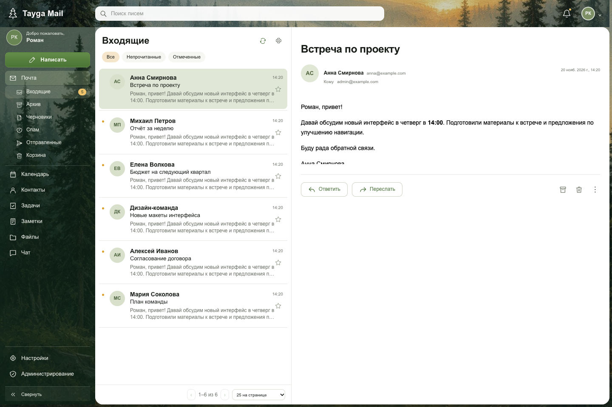
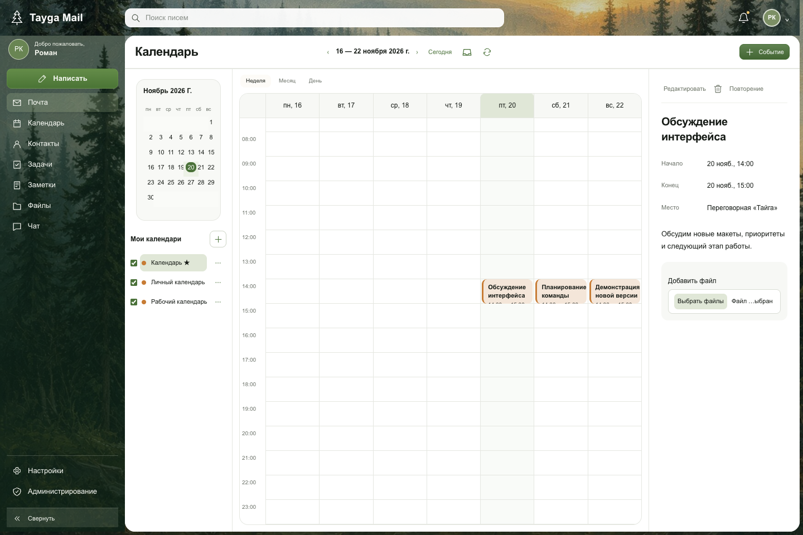
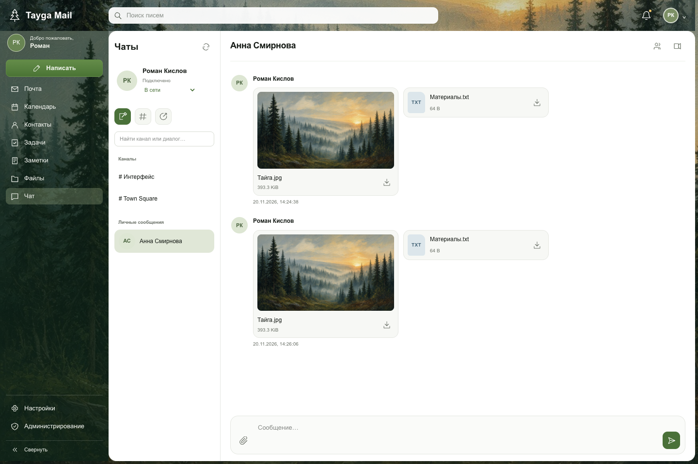
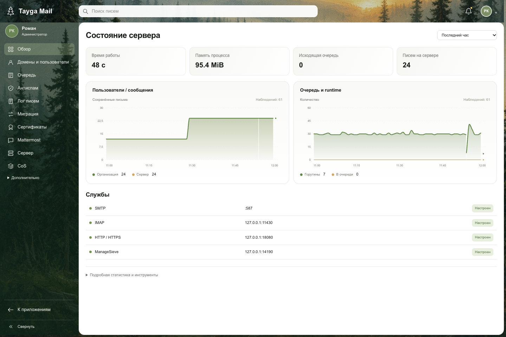

# Tayga Mail Server

**Почта и совместная работа на вашем сервере.**

**Русский** · [English](README.en.md)
[Скачать](https://github.com/rkislov/tayga-mail-server/releases/latest) · [Установка](docs/setup.md) · [Пользователю](docs/user-guide.md) · [Администратору](docs/admin-guide.md) · [Администратору домена](docs/domain-admin-guide.md) · [Скриншоты](docs/screenshots/README.md)

Tayga Mail Server — открытый сервер корпоративной почты и совместной работы. Он объединяет письма, календари, контакты, задачи, заметки, файлы и чаты в одном веб-пространстве. Организация размещает систему в своей инфраструктуре и управляет доменами, учётными записями, доступом и хранением данных.



## Почему Tayga

- **Данные под вашим управлением.** Вы выбираете сервер, хранилище, правила доступа и порядок резервного копирования.
- **Рабочий день в одном окне.** Почта, встречи, документы и обсуждения доступны из общего меню.
- **Спокойный интерфейс без рекламы.** Светлые панели, мягкие зелёные акценты, рисунки Алисы Кисловой, темы оформления и меню, которое сворачивается до иконок. Интерфейс доступен на русском и английском.
- **Привычные почтовые клиенты.** Открытые протоколы SMTP, IMAP, POP3 и DAV; FlowSync для поддерживаемых сценариев ActiveSync и EWS.
- **Несколько организаций в одной установке.** Организации, домены, пользователи, квоты и административные роли управляются централизованно.
- **Открытый код и понятное развёртывание.** Сервер написан на Go, веб-интерфейс встроен в исполняемый файл. Новая установка использует PostgreSQL. Дополнительные сервисы подключаются по необходимости.

## Возможности

### Почта

Папки, поиск, HTML-письма, вложения, черновики, подписи, отметки и массовые действия. По умолчанию список показывает 25 писем. Правила обработки и автоответ помогают разбирать входящую почту, а делегирование позволяет выдавать отдельные права на работу с ящиком.

На стороне сервера: SMTP/Submission/SMTPS, IMAP/IMAPS, POP3/POP3S, ManageSieve, доменные и почтовые алиасы, группы рассылки, квоты, архивирование, очередь повторной доставки и уведомления о недоставке. Можно подключать внешние ящики по IMAP или POP3.

[Алиасы](docs/mail-aliases.md) · [Фильтры](docs/setup-filters.md) · [Внешние ящики](docs/external-mail.md) · [Архив и поиск](docs/mail-archive-search.md)

### Календари, контакты, задачи и заметки

Календарь с видами дня, недели и месяца, приглашениями, повторяющимися встречами и подписками на внешние календари. Контакты и организационный справочник помогают находить коллег. Задачи и заметки хранят рабочие планы, текст и вложения рядом с почтой. CalDAV и CardDAV позволяют подключать совместимые приложения.



[Календари и приглашения](docs/calendar-scheduling.md) · [Организационный справочник](docs/organization-directory.md)

### Файлы и документы

Личные файлы и общие пространства, папки, поиск, история версий, корзина, права доступа и ссылки для обмена. WebDAV предоставляет доступ из совместимых клиентов. Изображения и PDF можно просматривать в браузере; для редактирования офисных документов подключается внешний Collabora Online, ONLYOFFICE или Р7.

[Файлы и офисные интеграции](docs/files-and-office.md)

### Чаты и встречи

Встроенный Mattermost-совместимый сервис поддерживает личные сообщения, открытые и закрытые каналы, поиск и вложения. В веб-чате есть аватары, статусы присутствия, предпросмотр изображений и значки форматов файлов. Тенант или домен может выбрать отдельно настроенный Jitsi Meet с Videobridge либо пространство Контур.Толка.



[Межсерверные каналы (экспериментально)](docs/mattermost-federation.md) · [Совместимость Mattermost](docs/mattermost-compatibility.md) · [Подключение ботов](docs/mattermost-bots.md) · [Видеовстречи](docs/vks.md)

### Агенты и DeepSeek API

Каталог агентов, личные диалоги с историей, навыки и настройки моделей в интерфейсе TMS. Доступны DeepSeek API, нативный Ollama, OpenAI (ChatGPT) и другие OpenAI-совместимые провайдеры. Настройки и ключи разделяются по тенантам и доменам, история — по пользователям. Платная лицензия не требуется. Это встроенная реализация TMS с навигацией по образцу Mattermost Agents; нативный экран Agents на iPhone, MCP и доступ к подключениям бота пока не входят в этот модуль.

Агент может скачать файл по публичной ссылке HTTP(S), подготовить временный документ, таблицу, презентацию или диаграмму и выполнить личную задачу по расписанию.

[SearXNG, OpenAI, DeepSeek, Ollama и GPUStack](docs/install-search-and-models.md) · [Агенты, изоляция и ограничения](docs/mattermost-agents.md)

### Boards и Playbooks — экспериментально

Оригинальный интерфейс Boards и сообщественный форк Tayga Playbooks подключаются как отдельные модули. В каждой области тенанта и домена они используют одну базу PostgreSQL с разными схемами и ролями. Файлы и настройки изолированы по продуктам. Проверены доски и карточки, создание и завершение запуска, а также выполнение задачи. Для этих сценариев достаточно открытых сборок. Расширенные автоматизации, вложения и мобильный интерфейс ещё требуют приёмки.

[Подготовка модулей и ограничения](docs/mattermost-products.md) · [Форк Playbooks и сборки](https://github.com/rkislov/tms-playbooks/releases/tag/v2.9.7-tms.1)

### Защита почты и входа

SPF, DKIM, DMARC и ARC, TLS, политики доставки, ограничения частоты запросов и карантин. Для анализа спама подключается Rspamd, для антивирусной проверки — ClamAV или другой поддерживаемый сканер. Администратор задаёт действия по результатам проверки.

Для входа доступны TOTP и ключи доступа WebAuthn, интеграции LDAP и OIDC. Ключи WebAuthn защищают веб-вход; доступ почтовых клиентов регулируется отдельно. Сертификатами можно управлять через веб-интерфейс, включая выпуск через ACME.

[Настройка защиты и доступа](docs/admin-guide.md) · [Сертификаты](docs/ca.md)

### Администрирование

Веб-консоль объединяет организации, домены, пользователей, классы обслуживания, настройки сервера, мониторинг и сертификаты. В очереди и журнале доставки можно разбирать задержки и отказы; подробности письма показывают связанные события и доступные ответы SMTP.

Для эксплуатации предусмотрены метрики Prometheus, миграция данных, зашифрованные полные резервные копии с проверкой и восстановлением. Сценарии высокой доступности описывают одну активную копию Tayga, управление переключением и общее либо реплицируемое состояние.



[Журнал доставки](docs/mail-delivery-logs.md) · [Миграция](docs/migration.md) · [Резервные копии](docs/backup-full.md) · [Высокая доступность](docs/ha.md)

## Совместимость и интеграции

- **Почтовые приложения:** SMTP, IMAP, POP3; Autodiscover и Mozilla autoconfig помогают с настройкой.
- **Календари, контакты и файлы:** CalDAV, CardDAV и WebDAV.
- **FlowSync:** собственная реализация части ActiveSync и EWS. Поддерживаемые операции и ограничения перечислены в [документе совместимости](docs/flowsync-compatibility.md); полная совместимость с Microsoft Exchange не заявляется.
- **Thunderbird:** расширение Tayga доступно в [выпуске](https://github.com/rkislov/tayga-mail-server/releases/latest) и имеет отдельную [инструкцию](extensions/thunderbird-tayga/README.md).
- **Инфраструктура:** LDAP/OIDC, Prometheus, дополнительное S3/MinIO-хранилище, внешние антиспам, антивирус, офисный редактор и видеосервис.

Набор работающих интеграций зависит от конфигурации. Поддержка Mattermost API и плагинов имеет [опубликованные границы совместимости](docs/mattermost-plugins.md).

## Установка

1. Скачайте архив для своей платформы и контрольные суммы из [GitHub Releases](https://github.com/rkislov/tayga-mail-server/releases/latest).
2. Подготовьте PostgreSQL, домен, DNS, TLS и каталоги данных по [инструкции установки](docs/setup.md).
3. Создайте конфигурацию на основе [примера](configs/tayga.example.yaml), задайте собственные данные первого администратора и запустите службу.
4. Откройте веб-интерфейс: основные параметры почты и интеграций находятся в разделе **Администрирование → Сервер**.

Доступны архивы для Linux и macOS (amd64/arm64), Windows (amd64/arm64), FreeBSD (amd64). Также доступны [DEB/RPM для Ubuntu, Astra Linux, ALT, CentOS Stream и РЕД ОС](docs/linux-packages.md), amd64/arm64; правила logrotate включены.

Пример конфигурации предназначен для первоначальной настройки. Если использованы демонстрационные `admin@example.com` / `changeme`, замените их до открытия доступа к серверу.

### Сборка из исходников

Потребуется версия Go, указанная в [go.mod](go.mod). Собранный веб-интерфейс уже включён в репозиторий.

```bash
git clone https://github.com/rkislov/tayga-mail-server.git
cd tayga-mail-server
CGO_ENABLED=0 go build -trimpath -ldflags="-s -w" -o tayga-mail ./cmd/tayga
./tayga-mail version
./tayga-mail menu -config /path/to/tayga.yaml
```

Для изменения интерфейса: `npm --prefix frontend ci` и `npm --prefix frontend run build`. Проверка сервера: `CGO_ENABLED=0 go test ./...`. Подробности — в [архитектуре](docs/architecture.md), [документации фронтенда](frontend/README.md) и [консольном меню](docs/cli-menu.md).

## Документация и развитие

- [Руководство пользователя](docs/user-guide.md) — повседневная работа со скриншотами.
- [Руководство администратора](docs/admin-guide.md) — настройка и эксплуатация.
- [Галерея интерфейса](docs/screenshots/README.md) — пользовательские разделы и администрирование.
- [Изменения 1.3.2](docs/release-1.3.2.md) и [дорожная карта](docs/roadmap.md).
- [Сравнение решений](docs/product-comparison.md) — отдельный обзор с указанием даты и источников.

Скриншоты сделаны в работающем приложении на демонстрационных данных. Возможности в дорожной карте обозначают планы, а не состав текущего выпуска.

## Автор и лицензии

<!-- owner-maintenance:start -->
**Автор проекта — Кислов Роман Сергеевич ([@rkislov](https://github.com/rkislov)).** Сообщения об ошибках и предложения принимаются через [Issues](https://github.com/rkislov/tayga-mail-server/issues), изменения — через Pull Requests из форков. Прямую запись в основной репозиторий и публикацию версий выполняет владелец `rkislov`.
<!-- owner-maintenance:end -->

Сервер и FlowSync — [Apache License 2.0](LICENSE); исходный код веб-интерфейса — [GPL-3.0](frontend/LICENSE). Условия сторонних компонентов указаны в [NOTICE](NOTICE) и соответствующих файлах лицензий.

Рисунки для фонов интерфейса — **Алиса Кислова**. Состав и авторство изображений приведены в [описании фонов](assets/wallpapers/README.md).

Агенты доступны также в личных чатах Mattermost с общей историей веток. Инструменты TMS: веб-поиск SearXNG/Brave, собственная почта и доступные каналы; отправка только после отдельного подтверждения.
