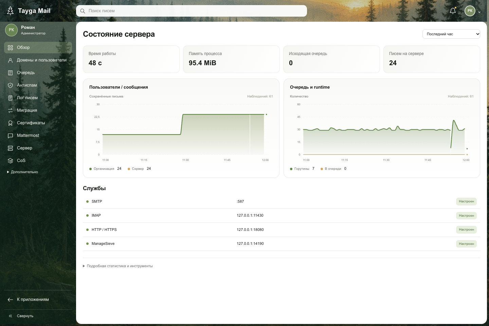
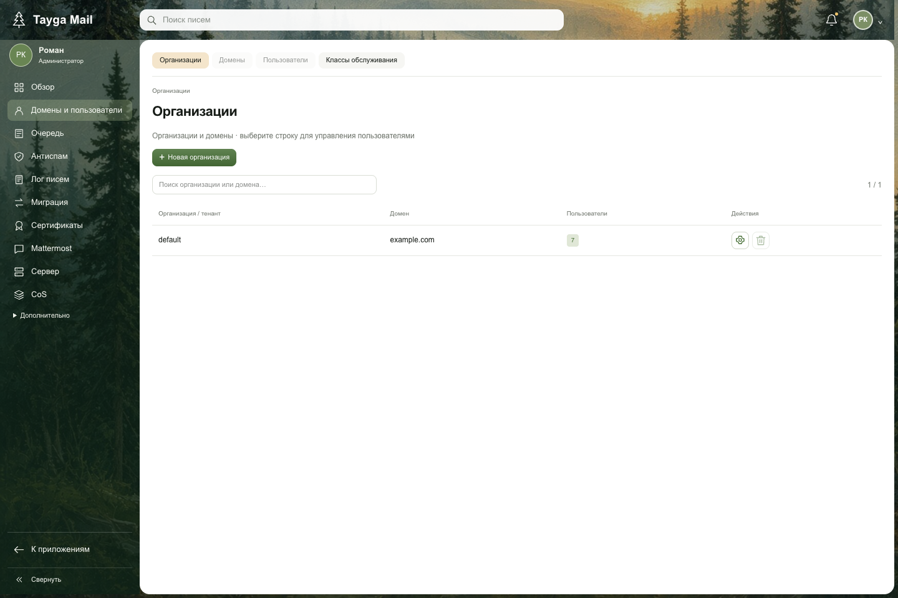
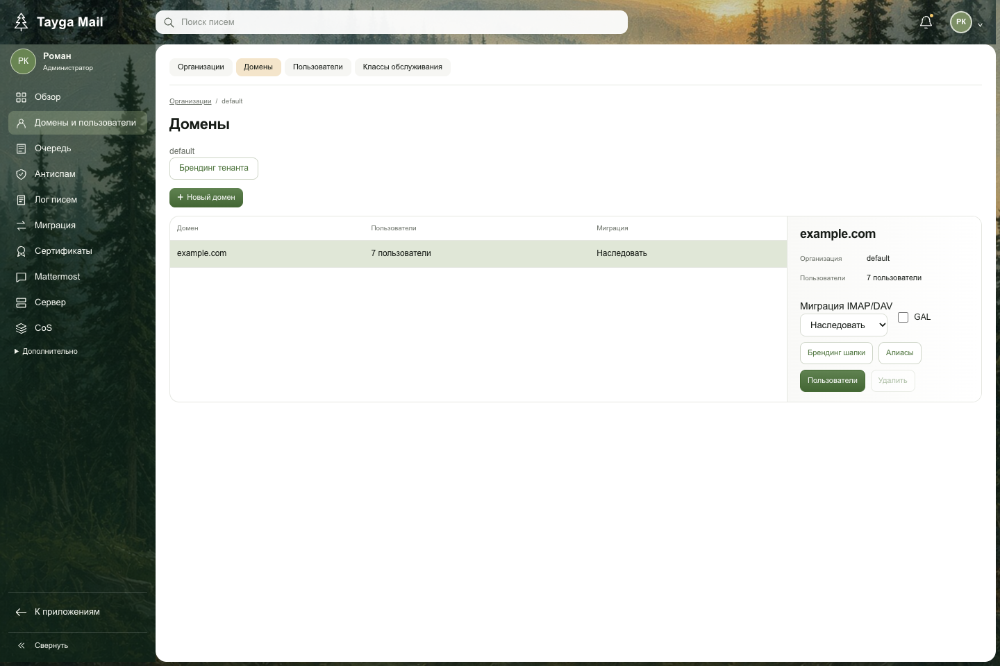
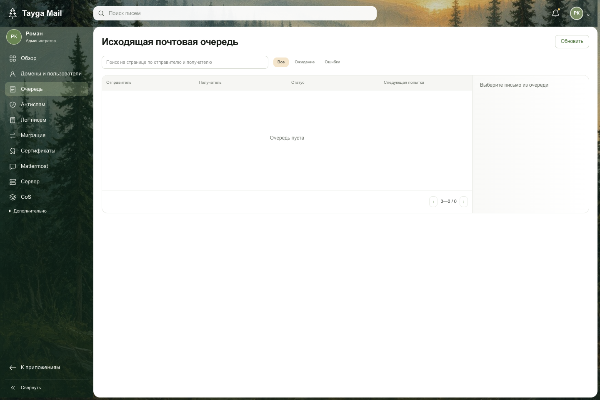
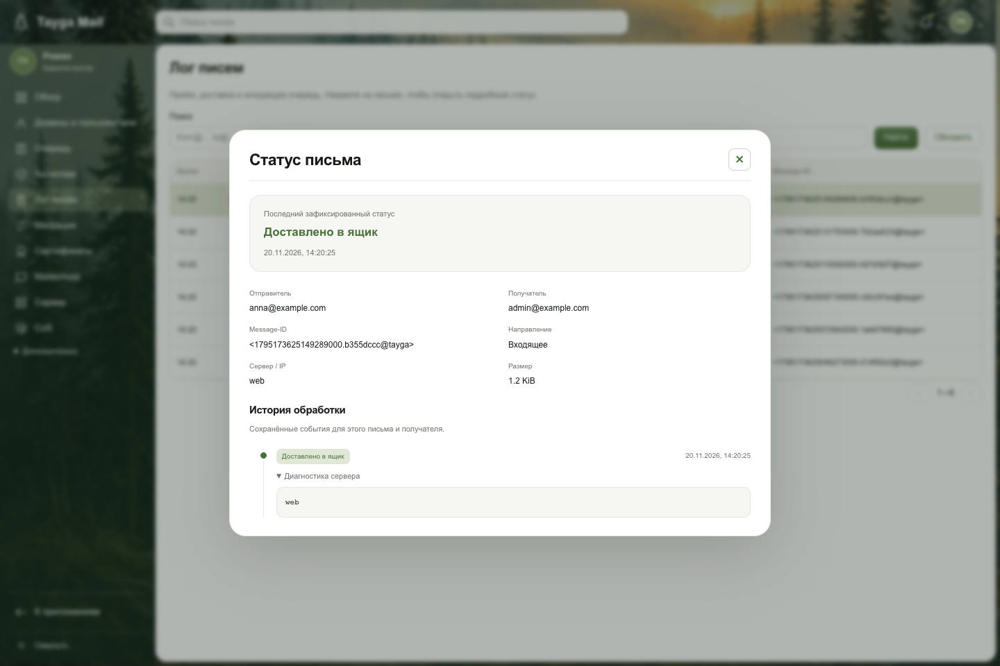
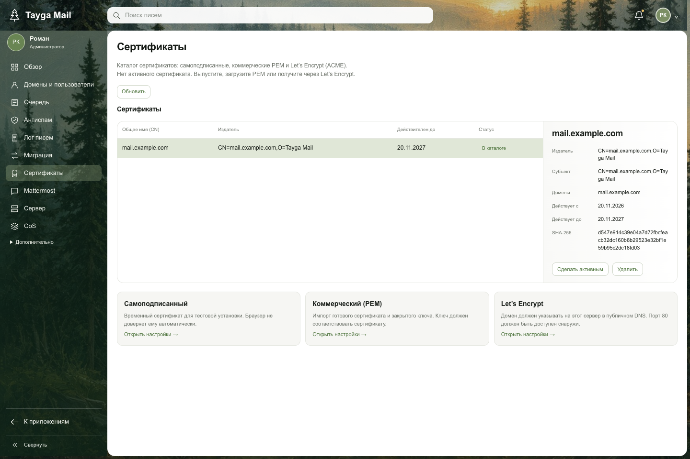
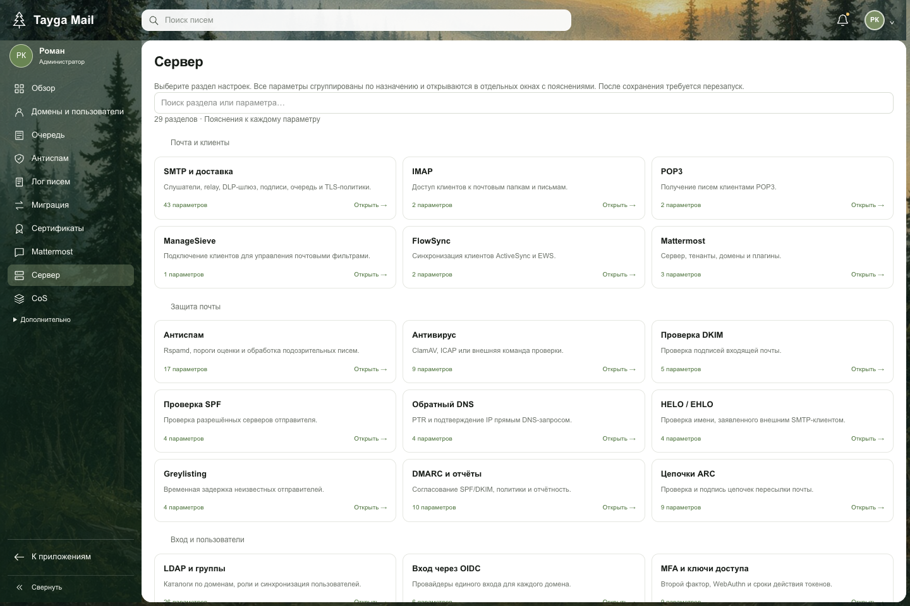
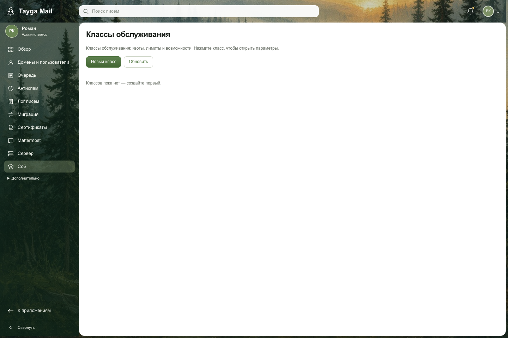

# Руководство администратора Tayga Mail 1.0.1

Это руководство описывает установку, обновление и работу административного пространства. [Руководство пользователя](user-guide.md) содержит повседневные операции. Скриншоты сделаны на отдельном работающем локальном стенде; адреса example.com и пользователи на них демонстрационные.

## Установка и первый вход

Полный порядок bootstrap, создания первого администратора, DNS и TLS приведён в [руководстве установки](setup.md). Пример минимального YAML — [configs/tayga.example.yaml](../configs/tayga.example.yaml), пример службы — [deploy/systemd/tayga.service](../deploy/systemd/tayga.service).

Распакуйте архив для нужной ОС и архитектуры, проверьте контрольную сумму, установите бинарный файл и подготовьте конфигурацию. Службу запускают от отдельной системной учётной записи с доступом только к необходимым каталогам данных. Задайте корректный публичный адрес, почтовые домены, DNS и сертификаты. После первого входа смените первоначальные реквизиты и проверьте доставку в обоих направлениях.

Основные рабочие настройки доступны через «Администрирование → Сервер». Bootstrap-параметры, помеченные только для чтения, меняются в конфигурации установки. Параметры, требующие перезапуска, имеют соответствующее пояснение в форме.

## Роли и административное меню

Переход «Администрирование» переключает левое меню на обзор сервера, домены и пользователей, очередь, антиспам, журнал писем, миграцию, сертификаты, Mattermost, сервер и CoS. «К приложениям» возвращает личное пространство. Меню сворачивается до иконок; подсказки доступны мышью и с клавиатуры.

Полномочия глобального администратора, администратора организации и администратора домена различаются. Сервер ограничивает доступные области данных и действий. Само наличие интерфейсного элемента не предоставляет права; отказ сервера не обходится изменением страницы. Дополнительные инструменты, например DKIM, роли и сессии, находятся в раскрываемой группе меню или в соответствующем разделе.

## Обзор сервера

Экран показывает основные показатели, историю метрик и настроенные слушатели служб. Карточки основаны на ответах сервера, графики — на сохранённых наблюдениях. Статус «Настроен» возле слушателя означает наличие конфигурации и не заменяет внешнюю проверку доступности порта. Значение памяти относится к процессу Go, а не ко всей оперативной памяти машины.

Выберите период истории. Пробелы на графиках означают отсутствие наблюдений или смену процесса; интерфейс не дорисовывает отсутствующие данные. Плавные линии проходят через фактические значения без искусственных пиков. Дополнительные графики, статистика и инструменты раскрываются ниже. Сырые метрики доступны через `/metrics` согласно конфигурации защиты установки.

## Организации, домены и пользователи

Откройте «Домены и пользователи». Выберите организацию и домен. Вкладки и строка пути показывают текущую область управления. Поиск ограничивает видимые записи. При создании домена проверьте DNS, маршрутизацию и права администратора.

Таблица пользователей показывает имя, email, состояние и использование квоты. Выберите строку: политики CoS, миграции и действия с пользователем появятся справа. Изменяйте квоту и разрешения осознанно; блокировка или удаление пользователя влияет на его доступ к данным. Для сброса пароля используйте действие карточки. Удаление подтверждается отдельно.

Алиасы домена и ящика, группы рассылки, оргструктура, права на почтовые ящики и делегирование настраиваются соответствующими действиями. Прямые и унаследованные права различаются. Для внешнего каталога и групп смотрите [оргструктуру](organization-directory.md), для секретарского доступа — [делегирование](delegation.md).

### Приветственное письмо

В настройках организации или домена можно подготовить приветственное письмо новым пользователям. Визуальный редактор поддерживает локальную загрузку фотографий. Сохранение создаёт версию; публикация выбирает версию для новых ящиков. Публикация не рассылает письмо существующим пользователям. Восстановление создаёт новую версию. Проверяйте наследование домена от организации и предпросмотр перед публикацией. Подробности — [приветственное письмо](welcome-mail.md).

## Исходящая очередь

Таблица содержит отправителя, получателя, состояние и время следующей попытки. Выбор строки открывает сведения об ошибке и действия справа. Поиск и переключатели на этом экране фильтруют текущую загруженную страницу; для остальных записей используйте навигацию страниц.

«Повторить» планирует немедленную повторную попытку, но не гарантирует приём внешним сервером. «Удалить» удаляет запись очереди без уведомления отправителя; проверьте адресата и причину перед подтверждением. При массовой задержке сначала проверьте DNS, сетевую доступность, TLS, политику внешнего получателя и журналы.

## Журнал доставки

Поиск работает по журналу приёма, доставки и исходящей очереди. Таблица показывает время, отправителя, получателя, событие и Message-ID. Нажатие на строку открывает окно с последним зафиксированным статусом, историей обработки, причиной ошибки и диагностикой SMTP. Закрыть его можно кнопкой или Escape. История ограничена идентификатором письма/транзакции, отправителем, получателем и областью прав администратора; при отсутствии идентификатора показывается только выбранная запись. Не считайте запись о постановке в очередь подтверждением окончательной внешней доставки.

Учитывайте область прав администратора и период хранения. Информация о событиях и диагностике — в [журналах доставки](mail-delivery-logs.md).

## Антиспам и карантин

Вкладка «Обзор» показывает карточки обучения и антивируса за выбранный период. Карантин и настройки вынесены в отдельные вкладки. Параметры Rspamd/DNSBL, антивируса, SPF, DKIM, DMARC и серого списка открываются отдельными действиями. Таблица карантина фильтруется по папке, типу и поисковой строке. Откройте письмо, чтобы увидеть безопасный текстовый просмотр и результаты проверок под таблицей. HTML карантинного письма не исполняется.

Выпуск письма перемещает его во входящие; обучение антиспама зависит от включённых настроек. Удаление из карантина подтверждается и необратимо для этой записи. Проверяйте результаты и заголовки, а не только числовую оценку. Дополнительные правила описаны в [почтовых фильтрах](setup-filters.md) и [DLP](mail-dlp.md).

## Сертификаты

В каталоге доступны самоподписанные сертификаты, загрузка PEM и выпуск через ACME. Выберите сертификат, чтобы увидеть издателя, субъект, домены, даты и отпечаток. Действия активации, продления и удаления зависят от типа и состояния сертификата. Самоподписанный сертификат не становится публично доверенным после добавления в каталог.

Для ACME требуются корректные DNS и доступность проверки. При загрузке PEM убедитесь, что ключ соответствует сертификату и права на файлы ограничены. После активации проверьте HTTPS и почтовые TLS-порты внешним клиентом. Храните резервные копии сертификатов и ключей вместе с конфигурацией в защищённом месте.

## Mattermost и видеоконференции

Административные настройки Mattermost разделены на подключение/политики, уведомления и интеграции. Выбор области определяет наследование сервер → организация → домен. Изменяются только параметры выбранной области. Секретные значения, отображаемые как маска, не заменяйте маской вручную.

Tayga предоставляет Mattermost-совместимый API; объём совместимости и плагины имеют явные границы. Наличие пакета плагина не подтверждает работу всех его функций. Подготовка Email ↔ Mattermost не включает пересылку автоматически. Фоновые push зависят от шлюза и клиентского приложения. Смотрите [совместимость](mattermost-compatibility.md), [плагины и приёмку](mattermost-plugins.md) и [видеоконференции Jitsi](vks.md).

В пользовательском и административном меню этого выпуска используется Mattermost. Устаревшие XMPP-компоненты в исходниках не являются обещанием наличия XMPP в новой веб-навигации.

## Параметры сервера

Каталог настроек содержит поиск и тематические группы. На широком экране выбранная форма открывается рядом с каталогом; на узком — отдельной панелью. Поля сопровождаются пояснениями. Внимательно проверьте текущие значения, примените изменения и выполните перезапуск, если он требуется этой группе.

При изменении адресов прослушивания, сертификатов, хранилища или прав подготовьте способ возврата к рабочей конфигурации. Настройки резервирования и кластеров описаны в [HA](ha.md), [одноплощадочной схеме](ha-single-site.md) и [двухплощадочной схеме](ha-two-sites.md).

## CoS

Класс обслуживания задаёт квоты, лимит письма, параметры больших вложений, ссылок и доступные возможности. Выберите класс слева и измените параметры справа. Назначение класса пользователю выполняется в его карточке. Перед изменением общего класса проверьте, какие пользователи его наследуют.

Серверные ограничения и права имеют приоритет над видимостью кнопок в браузере. Значение «без ограничения» следует интерпретировать в контексте конкретного поля и общей политики сервера.

## Миграция

Раздел миграции поддерживает подготовленные задачи переноса почты и данных DAV. Администратор выбирает целевую учётную запись в доступной области. Доступ к миграции регулируется пользовательской/доменной политикой и CoS. Используйте реквизиты исходного сервера и проверяйте TLS. Пропуск проверки сертификата применяется только к явно выбранной задаче и доверенному исходному серверу.

Начните с одной учётной записи, проверьте результат, затем расширяйте перенос. Фоновая задача и готовность исходного сервера определяют длительность; закрытие страницы не является отменой серверной задачи. Полная процедура — [миграция](migration.md).

## Резервирование и восстановление

Перед обновлением сохраните согласованную резервную копию БД, почтового хранилища, файлов, конфигурации, ключей и сертификатов. Копия одного бинарного файла не является резервной копией сервера. Для полного резервирования и проверки используйте [backup-full](backup-full.md); для конкретного скрипта установки соблюдайте описанный им порядок остановки и проверки данных.

Проверьте восстановление на отдельном экземпляре. Сохраняйте ключ расшифрования отдельно от зашифрованной копии. Контрольные суммы подтверждают целостность архивов, но не заменяют проверку содержимого и тестовое восстановление.

## Обновление до 1.0.0

1. Проверьте текущую версию, ОС и архитектуру, место на диске и рабочий способ административного доступа.
2. Получите подходящий архив выпуска и проверьте `checksums.txt`.
3. Изучите [описание 1.0.0](release-1.0.0.md). Подготовьте согласованную копию данных и конфигурации.
4. Остановите службу, установите бинарный файл атомарной заменой с сохранением владельца и режима доступа и запустите службу.
5. Проверьте журнал запуска и готовность, вход, чтение и отправку почты, календарь, файлы, Mattermost и критичные внешние клиенты.
6. При откате используйте подходящую копию состояния БД и файлов вместе с прежним бинарным файлом; не запускайте старую версию над непроверенной новой схемой.

Выпуск объединяет накопленные изменения и новые миграции 076–081: приветственные письма и их доставка, общие файловые пространства и восстановление, секретарское делегирование и EWS-делегаты. Миграции применяются сервером при запуске в установленном порядке. Резервная копия обязательна перед первым запуском новой версии над рабочими данными.

## Документация и помощь

- [Первичная настройка](setup.md)
- [Полное резервное копирование](backup-full.md)
- [Файлы и офис](files-and-office.md)
- [FlowSync и клиенты](flowsync-compatibility.md)
- [Галерея интерфейса](screenshots/README.md)
- [Руководство пользователя](user-guide.md)

При диагностике фиксируйте версию сервера, время события, область администратора, Message-ID или идентификатор задачи и текст ошибки. Не включайте в публичные отчёты пароли, приватные ключи, токены и действующие приватные ссылки.

## Исправления 1.0.1

См. [описание выпуска](release-1.0.1.md). Для восстановления полной копии с обычными Unix-именами Maildir (`:2,S`) используйте 1.0.1 или новее. Обновление с 1.0.0 не изменяет схему БД. Ротация текущего файлового журнала по-прежнему использует `copytruncate`; сигнал SIGHUP для переоткрытия файла этой версией не поддерживается.
