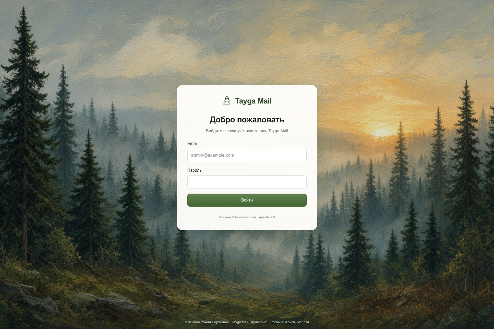
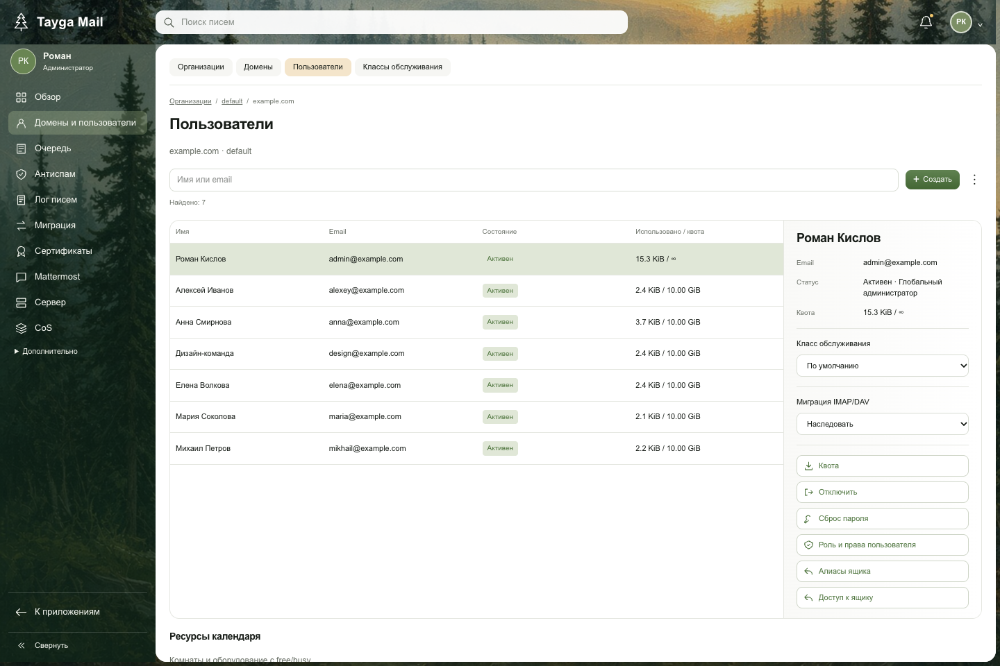
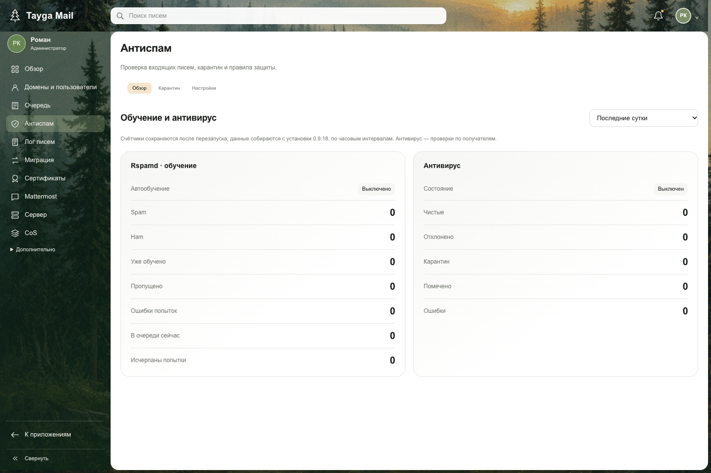
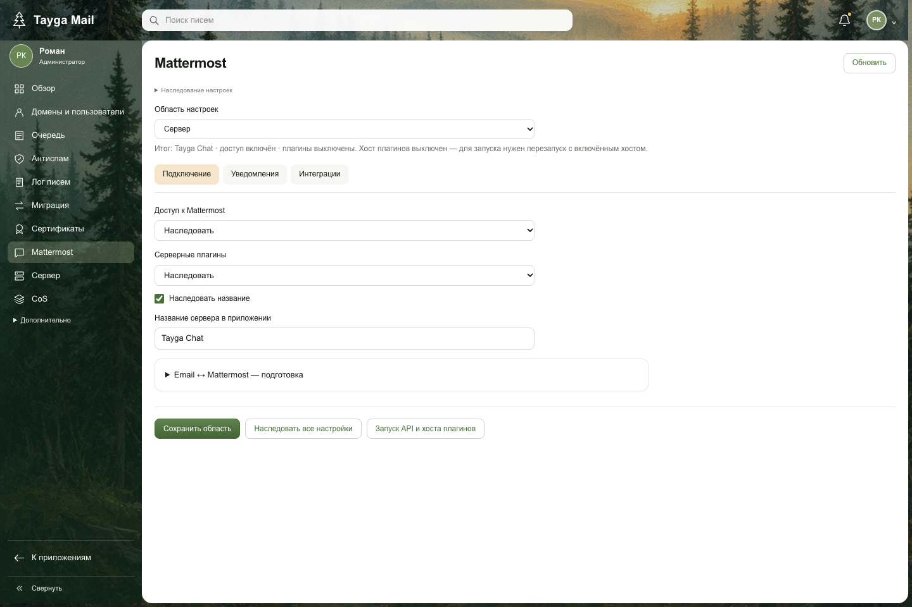
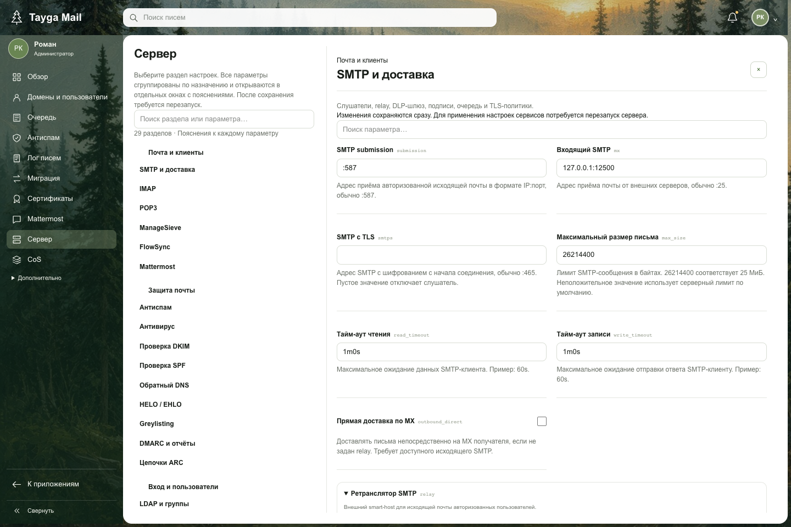
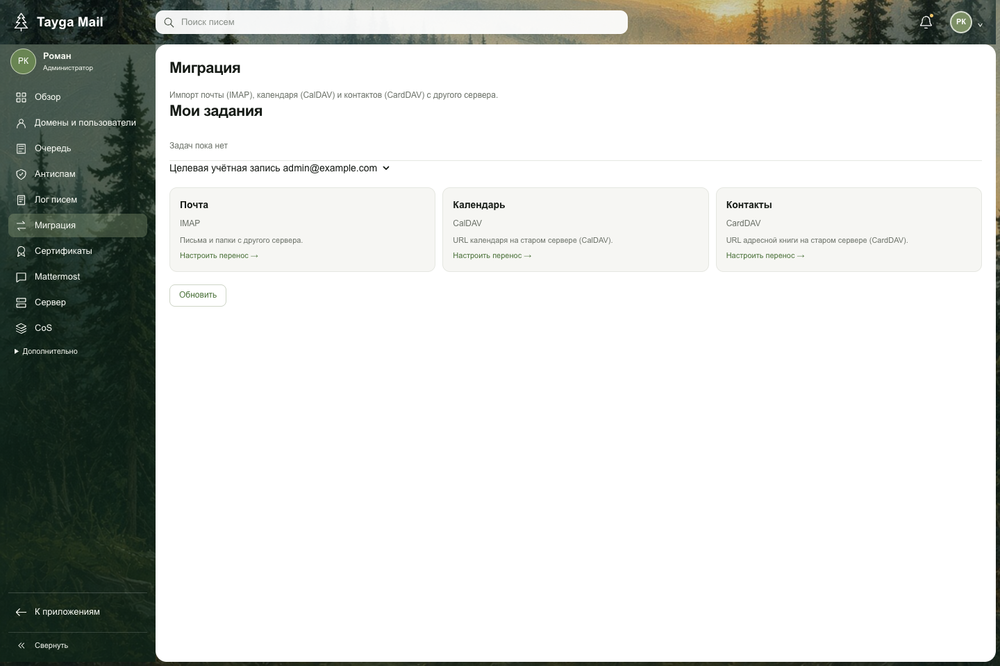

# Руководство администратора Tayga Mail 1.3.0

Это руководство описывает установку, обновление и работу административного пространства. [Руководство пользователя](user-guide.md) содержит повседневные операции. Скриншоты сделаны на отдельном работающем локальном стенде; адреса example.com и пользователи на них демонстрационные.

## Установка и первый вход

При чистой установке пройдите [пошаговую настройку](setup.md). Она охватывает выделенную базу PostgreSQL, первоначального администратора, DNS, TLS, почтовые протоколы, Mattermost и внешние сервисы.

Полный порядок bootstrap, создания первого администратора, DNS и TLS приведён в [руководстве установки](setup.md). Пример минимального YAML — [configs/tayga.example.yaml](../configs/tayga.example.yaml), пример службы — [deploy/systemd/tayga.service](../deploy/systemd/tayga.service).

Распакуйте архив для нужной ОС и архитектуры, проверьте контрольную сумму, установите бинарный файл и подготовьте конфигурацию. Службу запускают от отдельной системной учётной записи с доступом только к необходимым каталогам данных. Задайте корректный публичный адрес, почтовые домены, DNS и сертификаты. После первого входа смените первоначальные реквизиты и проверьте доставку в обоих направлениях.



Основные рабочие настройки доступны через «Администрирование → Сервер». Bootstrap-параметры, помеченные только для чтения, меняются в конфигурации установки. Параметры, требующие перезапуска, имеют соответствующее пояснение в форме.

## Роли и административное меню

Переход «Администрирование» переключает левое меню на обзор сервера, домены и пользователей, очередь, антиспам, журнал писем, миграцию, сертификаты, Mattermost, сервер и CoS. «К приложениям» возвращает личное пространство. Меню сворачивается до иконок; подсказки доступны мышью и с клавиатуры.

Полномочия глобального администратора, администратора организации и администратора домена различаются. Сервер ограничивает доступные области данных и действий. Само наличие интерфейсного элемента не предоставляет права; отказ сервера не обходится изменением страницы. Дополнительные инструменты, например DKIM, роли и сессии, находятся в раскрываемой группе меню или в соответствующем разделе.

## Обзор сервера

Экран показывает основные показатели, историю метрик и настроенные слушатели служб. Карточки основаны на ответах сервера, графики — на сохранённых наблюдениях. Статус «Настроен» возле слушателя означает наличие конфигурации и не заменяет внешнюю проверку доступности порта. Значение памяти относится к процессу Go, а не ко всей оперативной памяти машины.


Выберите период истории. Пробелы на графиках означают отсутствие наблюдений или смену процесса; интерфейс не дорисовывает отсутствующие данные. Плавные линии проходят через фактические значения без искусственных пиков. Дополнительные графики, статистика и инструменты раскрываются ниже. Сырые метрики доступны через `/metrics` согласно конфигурации защиты установки.

## Организации, домены и пользователи

Откройте «Домены и пользователи». Выберите организацию и домен. Вкладки и строка пути показывают текущую область управления. Поиск ограничивает видимые записи. При создании домена проверьте DNS, маршрутизацию и права администратора.


Таблица пользователей показывает имя, email, состояние и использование квоты. Выберите строку: политики CoS, миграции и действия с пользователем появятся справа. Изменяйте квоту и разрешения осознанно; блокировка или удаление пользователя влияет на его доступ к данным. Для сброса пароля используйте действие карточки. Удаление подтверждается отдельно.



Алиасы домена и ящика, группы рассылки, оргструктура, права на почтовые ящики и делегирование настраиваются соответствующими действиями. Прямые и унаследованные права различаются. Для внешнего каталога и групп смотрите [оргструктуру](organization-directory.md), для секретарского доступа — [делегирование](delegation.md).

### Приветственное письмо

В настройках организации или домена можно подготовить приветственное письмо новым пользователям. Визуальный редактор поддерживает локальную загрузку фотографий. Сохранение создаёт версию; публикация выбирает версию для новых ящиков. Публикация не рассылает письмо существующим пользователям. Восстановление создаёт новую версию. Проверяйте наследование домена от организации и предпросмотр перед публикацией. Подробности — [приветственное письмо](welcome-mail.md).

## Исходящая очередь

Таблица содержит отправителя, получателя, состояние и время следующей попытки. Выбор строки открывает сведения об ошибке и действия справа. Поиск и переключатели на этом экране фильтруют текущую загруженную страницу; для остальных записей используйте навигацию страниц.


«Повторить» планирует немедленную повторную попытку, но не гарантирует приём внешним сервером. «Удалить» удаляет запись очереди без уведомления отправителя; проверьте адресата и причину перед подтверждением. При массовой задержке сначала проверьте DNS, сетевую доступность, TLS, политику внешнего получателя и журналы.

## Журнал доставки

Поиск работает по журналу приёма, доставки и исходящей очереди. Таблица показывает время, отправителя, получателя, событие и Message-ID. Нажатие на строку открывает окно с последним зафиксированным статусом, историей обработки, причиной ошибки и диагностикой SMTP. Закрыть его можно кнопкой или Escape. История ограничена идентификатором письма/транзакции, отправителем, получателем и областью прав администратора; при отсутствии идентификатора показывается только выбранная запись. Не считайте запись о постановке в очередь подтверждением окончательной внешней доставки.


Учитывайте область прав администратора и период хранения. Информация о событиях и диагностике — в [журналах доставки](mail-delivery-logs.md).

## Антиспам и карантин

Вкладка «Обзор» показывает карточки обучения и антивируса за выбранный период. Карантин и настройки вынесены в отдельные вкладки. Параметры Rspamd/DNSBL, антивируса, SPF, DKIM, DMARC и серого списка открываются отдельными действиями. Таблица карантина фильтруется по папке, типу и поисковой строке. Откройте письмо, чтобы увидеть безопасный текстовый просмотр и результаты проверок под таблицей. HTML карантинного письма не исполняется.



Выпуск письма перемещает его во входящие; обучение антиспама зависит от включённых настроек. Удаление из карантина подтверждается и необратимо для этой записи. Проверяйте результаты и заголовки, а не только числовую оценку. Дополнительные правила описаны в [почтовых фильтрах](setup-filters.md) и [DLP](mail-dlp.md).

## Сертификаты

В каталоге доступны самоподписанные сертификаты, загрузка PEM и выпуск через ACME. Выберите сертификат, чтобы увидеть издателя, субъект, домены, даты и отпечаток. Действия активации, продления и удаления зависят от типа и состояния сертификата. Самоподписанный сертификат не становится публично доверенным после добавления в каталог.


Для ACME требуются корректные DNS и доступность проверки. При загрузке PEM убедитесь, что ключ соответствует сертификату и права на файлы ограничены. После активации проверьте HTTPS и почтовые TLS-порты внешним клиентом. Храните резервные копии сертификатов и ключей вместе с конфигурацией в защищённом месте.

## Mattermost и видеоконференции

Административные настройки Mattermost разделены на подключение/политики, уведомления и интеграции. Выбор области определяет наследование сервер → организация → домен. Изменяются только параметры выбранной области. Секретные значения, отображаемые как маска, не заменяйте маской вручную.



Tayga предоставляет Mattermost-совместимый API; объём совместимости и плагины имеют явные границы. Наличие пакета плагина не подтверждает работу всех его функций. Подготовка Email ↔ Mattermost не включает пересылку автоматически. Фоновые push зависят от шлюза и клиентского приложения. Смотрите [совместимость](mattermost-compatibility.md), [плагины и приёмку](mattermost-plugins.md) и [видеоконференции Jitsi](vks.md).

В пользовательском и административном меню этого выпуска используется Mattermost. Устаревшие XMPP-компоненты в исходниках не являются обещанием наличия XMPP в новой веб-навигации.

## Параметры сервера

Каталог настроек содержит поиск и тематические группы. На широком экране выбранная форма открывается рядом с каталогом; на узком — отдельной панелью. Поля сопровождаются пояснениями. Внимательно проверьте текущие значения, примените изменения и выполните перезапуск, если он требуется этой группе.




При изменении адресов прослушивания, сертификатов, хранилища или прав подготовьте способ возврата к рабочей конфигурации. Настройки резервирования и кластеров описаны в [HA](ha.md), [одноплощадочной схеме](ha-single-site.md) и [двухплощадочной схеме](ha-two-sites.md).

## CoS

Класс обслуживания задаёт квоты, лимит письма, параметры больших вложений, ссылок и доступные возможности. Выберите класс слева и измените параметры справа. Назначение класса пользователю выполняется в его карточке. Перед изменением общего класса проверьте, какие пользователи его наследуют.


Серверные ограничения и права имеют приоритет над видимостью кнопок в браузере. Значение «без ограничения» следует интерпретировать в контексте конкретного поля и общей политики сервера.

## Миграция

Раздел миграции поддерживает подготовленные задачи переноса почты и данных DAV. Администратор выбирает целевую учётную запись в доступной области. Доступ к миграции регулируется пользовательской/доменной политикой и CoS. Используйте реквизиты исходного сервера и проверяйте TLS. Пропуск проверки сертификата применяется только к явно выбранной задаче и доверенному исходному серверу.



Начните с одной учётной записи, проверьте результат, затем расширяйте перенос. Фоновая задача и готовность исходного сервера определяют длительность; закрытие страницы не является отменой серверной задачи. Полная процедура — [миграция](migration.md).

## Резервирование и восстановление

### Установка с PostgreSQL

1. Определите окно обслуживания и каталог на отдельном томе. Ограничьте
   доступ к каталогу копии, зашифруйте её и храните ключ отдельно.
2. Остановите Tayga и другие процессы, способные писать в базы или файловое
   хранилище. Для локальной БД сделайте логический дамп основной базы
   и отдельно каждой используемой базы Boards/Playbooks. При внешнем
   PostgreSQL используйте снимок провайдера или `pg_dump` совместимой версии.
3. Скопируйте YAML и systemd overrides, maildir, вложения, каталоги плагинов
   и привязки их БД, сертификаты, секреты Tayga и VKS. Включите согласованную
   копию внешнего файлового хранилища, если оно используется. Сохраните
   конфигурации и постоянные данные Jitsi, SearXNG и GPUStack на их узлах.
4. Проверьте архивы, запись инструкции восстановления и возобновите Tayga.
   Для каждого дампа `pg_restore --list` должно завершиться успешно.
   Проверьте копию пробным восстановлением на изолированном узле.

Пример логического дампа локальной базы. Заранее создайте защищённый каталог
`/backup/tayga` на отдельном носителе. Выполните в root-shell в согласованное
окно с остановленной Tayga. Подставьте имя основной БД из своей установки:

```sh
umask 077
backup_dir=$(mktemp -d /backup/tayga/snapshot.XXXXXXXX)
sudo -u postgres pg_dump -Fc -d tayga >"$backup_dir/main.dump"
pg_restore --list "$backup_dir/main.dump" >/dev/null
```

Повторите для каждой базы плагина, задав отдельное имя файла дампа.
Параметры ролей и привязки к БД сохраните вместе с копией либо пересоздайте
из закрытого реестра. Содержимое DSN могло дать доступ к почте и чатам,
поэтому храните файлы привязки и резервные архивы как секреты. При
восстановлении на стенде сначала создайте пустые БД и непривилегированные
роли, восстановите основной дамп и файлы, затем восстановите базы модулей
и привязки. Запускайте Tayga с DSN стенда, изолировав исходящую почту и
внешних ботов. Проверьте наличие писем и вложений, чатов, досок, сценариев и
возможность входа. Если в контуре применяются снимки, восстановите
согласованную пару БД и файлов из одной точки.

Для [`backup-full`](backup-full.md) действуют отдельные ограничения по
основной БД, внешним хранилищам и путям. Для основной PostgreSQL используйте
процедуру выше. Схема резервирования БД и привязок оригинальных модулей
описана в [Boards и Playbooks](mattermost-products.md#backup-and-restore).

## Обновление до 1.0.0

1. Проверьте текущую версию, ОС и архитектуру, место на диске и рабочий способ административного доступа.
2. Получите подходящий архив выпуска и проверьте `checksums.txt`.
3. Изучите [описание 1.0.0](release-1.0.0.md). Подготовьте согласованную копию данных и конфигурации.
4. Остановите службу, установите бинарный файл атомарной заменой с сохранением владельца и режима доступа и запустите службу.
5. Проверьте журнал запуска и готовность, вход, чтение и отправку почты, календарь, файлы, Mattermost и критичные внешние клиенты.
6. При откате используйте подходящую копию состояния БД и файлов вместе с прежним бинарным файлом; не запускайте старую версию над непроверенной новой схемой.

Выпуск объединяет накопленные изменения и новые миграции 076–081: приветственные письма и их доставка, общие файловые пространства и восстановление, секретарское делегирование и EWS-делегаты. Миграции применяются сервером при запуске в установленном порядке. Резервная копия обязательна перед первым запуском новой версии над рабочими данными.

## Документация и помощь

- [Установка с PostgreSQL и подбор параметров](setup.md)
- [SearXNG, OpenAI, DeepSeek, Ollama и GPUStack](install-search-and-models.md)
- [Установка Jitsi и сетевые проверки](vks.md)
- [Руководство администратора домена](domain-admin-guide.md)
- [Полное резервное копирование](backup-full.md)
- [Файлы и офис](files-and-office.md)
- [FlowSync и клиенты](flowsync-compatibility.md)
- [Галерея интерфейса](screenshots/README.md)
- [Руководство пользователя](user-guide.md)

При диагностике фиксируйте версию сервера, время события, область администратора, Message-ID или идентификатор задачи и текст ошибки. Не включайте в публичные отчёты пароли, приватные ключи, токены и действующие приватные ссылки.

## Исправления 1.0.1

См. [описание выпуска](release-1.0.1.md). Для восстановления полной копии с обычными Unix-именами Maildir (`:2,S`) используйте 1.0.1 или новее. Обновление с 1.0.0 не изменяет схему БД. Ротация текущего файлового журнала по-прежнему использует `copytruncate`; сигнал SIGHUP для переоткрытия файла этой версией не поддерживается.

## Мониторинг в 1.0.2

Главный экран показывает CPU и память всей Linux-машины, исходящую очередь и время работы. Графики отражают принятые и отклонённые входящие доставки, классификацию спама, загрузку CPU и RAM. Накопленные письма, Go heap, горутины и сетевые счётчики доступны в «Подробной статистике и инструментах».

Счётчики доставки учитываются по получателям, показатели спама — по результатам сканирования и пересекаются с доставками. Они не являются четырьмя взаимоисключающими категориями. История сохраняется раз в минуту; для скорости доставки и CPU нужны два последовательных наблюдения. Полные определения, ограничения платформы и поведение после перезапуска — в [описании 1.0.2](release-1.0.2.md).

## Внешние боты Mattermost

Во вкладке **Mattermost → Боты** выберите домен, создайте бота и скопируйте одноразово показанный токен. Доступны замена токена и отключение учётной записи. Порядок подключения REST/WebSocket, права и вебхуки — в [руководстве по ботам](mattermost-bots.md).

## DLP и SIEM

Для внешней исходящей почты доступен [SMTP-шлюз DLP](mail-dlp.md), для событий входа и почтового журнала — [syslog/CEF в SIEM](siem.md). Включайте подключения после задания адресов и проверки приёмников. Проверка локальных стендов не означает, что внешние системы уже подключены.

## Агенты и DeepSeek: эксплуатация в 1.3.0

Для повседневной работы см. [руководство пользователя](user-guide.md), для
локального управления — [руководство администратора домена](domain-admin-guide.md).
Agents встроен в TMS и не требует установки оригинального плагина Mattermost
или платной лицензии. Это отдельная реализация интерфейса с каталогом,
личными диалогами, навыками-инструкциями и настройками моделей.

### Права и подключение провайдера

Настройки Agents принадлежат паре тенант/домен текущей учётной записи. Даже
глобальный администратор в этом экране редактирует именно этот домен; выбор
области в другом административном разделе не меняет Agents. Администратор
домена должен иметь право управления доменом текущего адреса. Серверные ключи
не наследуются всеми доменами автоматически.

Настройте DeepSeek через «Агенты → Настройки → Подключить модель», затем
создайте и включите агента. Пустой каталог до настройки — ожидаемое состояние.
Провайдеры/агенты не создаются автоматически из конфигурации aiagent-бота.
API-ключ вводится только в защищённой форме своего домена. Запросы идут с сервера
TMS; исходящий HTTPS, DNS, CA-сертификаты и средства контроля расходов должны
быть настроены на сервере. Не отключайте проверку TLS для устранения ошибок.

Сервер использует `/chat/completions`, не следует перенаправлениям и не выдаёт
ключ обратно в браузер. У варианта DeepSeek допустим официальный API-адрес,
у совместимого API — HTTPS либо HTTP только на loopback. Локальный HTTP-сервис
должен быть доступен со стороны сервера TMS, а не компьютера пользователя.

Согласуйте использование внешнего провайдера с политикой организации: ему
передаются сообщения текущего диалога и инструкции агента. Техническая
изоляция пользователей не отменяет передачи этих данных провайдеру.

### Хранилище, резервное копирование и восстановление

Конфигурация и истории находятся в основной БД TMS в таблице `settings` под
префиксами `mattermost.agents.config:` и `mattermost.agents.history:`. Новых
миграций именно для Agents в 1.3.0 нет. Они включены в копию основной БД;
отдельная база PostgreSQL для этого продукта не требуется. Устанавливать
Boards/Playbooks ради Agents не нужно.

API-ключ хранится в конфигурации БД без отдельного шифрования поля. Ограничьте
доступ к БД и файлам резервных копий, используйте зашифрованные копии и храните
ключ восстановления отдельно. Нельзя включать эти записи в открытые дампы
или диагностические архивы. Удаление учётной записи пока не удаляет её записи
Agents автоматически; учитывайте это при политике хранения и удалении данных.

Перед обновлением остановите записи и снимите согласованную копию основной
БД, конфигурации и файлов. Если используются Boards/Playbooks, включите их
отдельные базы/файлы согласно [инструкции модулей](mattermost-products.md).
Проверьте целостность копии и сохраните прежний бинарник. При переходе с 1.1.0
нужно учитывать миграцию 083: для отката сохраните соответствующую БД, а не
только исполняемый файл. Не заменяйте изменившуюся после обновления БД старой
копией без учёта новых писем/сообщений.

### Нагрузка и диагностика

В 1.3.0 генерация ограничена четырьмя запросами одновременно на процесс,
тайм-аутом 120 секунд, до 100 диалогов на пользователя, 200 сообщений в одном
диалоге и 16 МиБ общей записи истории пользователя. Состояние неудачного запроса
не записывается как успешный обмен. Незавершённая после аварии заявка истекает
через 150 секунд. Поддерживается один записывающий процесс TMS; несколько
экземпляров на общей БД для Agents пока не поддерживаются.

В системном журнале фильтруйте `agents audit`. События `configuration`,
`conversation_created`, `conversation_deleted`, `turn_started`,
`turn_completed`, `turn_failed` содержат область, пользователя и ID диалога,
без текстов и ключей. Для systemd-установки с именем службы `tayga`:

```sh
sudo journalctl -u tayga --since '15 minutes ago' --no-pager
systemctl is-active tayga
```

При ошибке ответа проверьте состояние сервиса, исходящий DNS/HTTPS, доступность
модели, лимиты и ключ провайдера. Не добавляйте ключ в URL, аргументы общей
командной строки или логи. Проверка сервера и синтетический тест адаптера не
заменяют оплачиваемый запрос с действительным ключом.

### Границы продукта

Поддерживается встроенный интерфейс TMS. Нет нативного экрана Agents на iPhone,
MCP/OAuth, исполнения инструментов, входных файлов модели, потоковых ответов,
синхронизации с историей aiagent-бота и индивидуальных ACL агентов внутри домена.
Навык — инструкция, не код. Не выдавайте боту глобальные административные права
как способ включить эти возможности. [Техническая справка](mattermost-agents.md).


### Нативный Ollama и OpenAI

В настройках моделей доступны отдельные типы Ollama и OpenAI (ChatGPT).
Для Ollama используется `/api/chat`; локальный адрес относится к машине TMS,
а модель должна быть предварительно установлена оператором движка. Не требуется
разворачивать движок на почтовом узле: можно подключить отдельный сервер.
Проверяйте доступность адреса со стороны TMS и планируйте ресурсы на узле Ollama.
Автоматической установки движка или скачивания моделей нет.

Ollama допускает HTTP только для loopback и числовых частных адресов; публичные
узлы и удалённые DNS-имена требуют HTTPS. OpenAI закреплён за официальным API
и требует отдельного ключа. Коннекторы не получают почту или подключения
владельца бота и используют прежние ограничения контекста пользователя.
[Параметры и протоколы](mattermost-agents.md).

### Общие диалоги агентов и инструменты

Агенты доступны также как боты в личных сообщениях Mattermost: `/agents`
показывает каталог домена. Одна ветка DM соответствует одному веб-диалогу;
сообщения и контекст общие. Для продолжения конкретного диалога откройте его
ветку. `/agent-web on|off|status` управляет веб-поиском этого диалога.

Разрешения почты, чатов и веба администратор задаёт отдельно для каждого агента.
Почта и каналы читаются от текущего пользователя. Отправка требует показа
получателя и полного текста, затем кнопки подтверждения или `/agent-confirm ID`.
Подтверждение одноразовое, на 10 минут. SearXNG без ключа или Brave Search
настраиваются в настройках домена. [Подробности и ограничения](mattermost-agents.md#общая-история-с-mattermost-и-инструменты).

Доски создаются в оригинальном интерфейсе Boards: откройте продукт и нажмите
«+» → «Create new board». В Mattermost доступны `/boards` и действие «Доски
Boards» в информации о канале при активном плагине. На iPhone доска открывается
в браузере; при необходимости войдите в TMS. Встроенного нативного редактора
Boards в приложении Mattermost это обновление не добавляет.

### Полная миграция основной БД

Для SQLite → PostgreSQL используйте `tayga-mail migrate-storage`, а не логический экспорт. Переносятся все прикладные таблицы со сверкой содержимого. Сохраните абсолютный `mattermost.attachment_directory`, чтобы файлы чата оставались доступны. [Полная инструкция](storage-migration.md).

### Объём синхронизации и забытые телефоны

В состояниях EWS/EAS общие снимки хранятся без дублирования по пользователю и
коллекции, сжатие/восстановление сохраняет ключи и replay-ответы. Старые записи
можно уплотнить офлайн командой `compact-sync-state -apply -vacuum`; отчёт сверки
не содержит содержимого почты. Срок хранения неактивного EWS-контекста — 180 дней
по умолчанию (`flowsync.state_retention_days`, 0 выключает). Квитанции отправки/
создания задач и действующие EAS-устройства общий TTL не затрагивает.

Для сброшенного телефона используйте «Забыть на сервере», а не удалённую очистку.
Запись скрывается из обычного списка, её ID остаётся заблокированным. Включите
«Показать забытые», чтобы восстановить запись: сначала она возвращается с
блокировкой и новым Provision, затем её можно отдельно разрешить. Старая команда
очистки не возобновляется. [Подробности](storage-migration.md).

## Резервные копии, сессии и устройства

В меню «Администрирование» откройте отдельные страницы «Резервные копии», «Сессии» и «Устройства». Экспорт с веб-страницы относится к организации. Для аварийного восстановления всей установки используйте согласованную копию PostgreSQL, почтовых файлов, вложений, настроек и баз плагинов. Сессии Mattermost видны до истечения срока действия. Завершение сессии отзывает её токен. Устройства ActiveSync можно заблокировать, забыть на сервере и восстановить отдельно.
