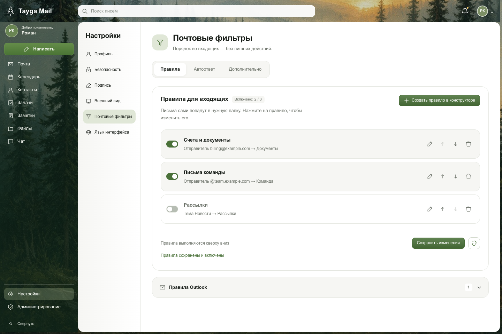
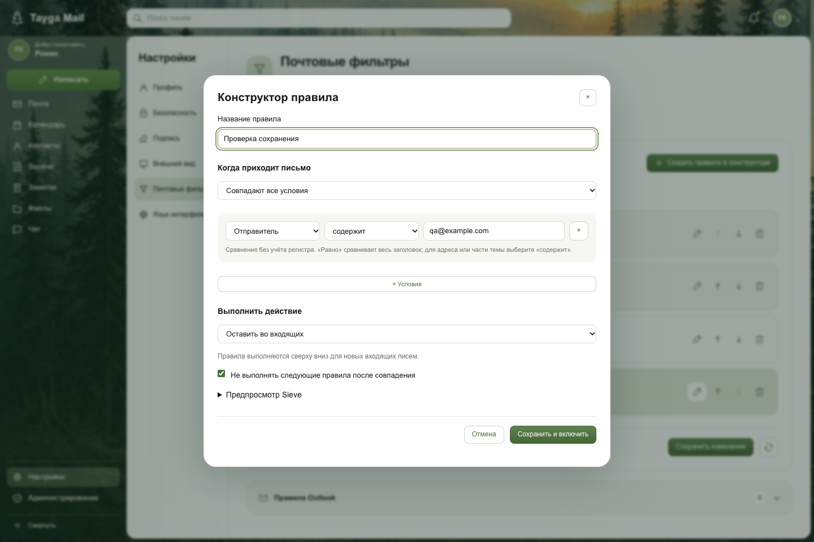

# Почтовые фильтры и визуальный конструктор

Откройте **Настройки → Почтовые фильтры → Правила**. Визуальный редактор не требует знания Sieve: нажмите **Создать правило в конструкторе**.

Укажите название, условия по отправителю, получателю, копии или теме, затем выберите действие: перемещение в папку, сохранение во входящих либо удаление без корзины. Для поиска адреса внутри заголовка используйте «содержит»; «равно» сравнивает весь заголовок. Несколько условий можно объединить по принципу «все» или «хотя бы одно».

**Сохранить и включить** в редакторе записывает правила на сервер. Чтобы изменить существующее правило, нажмите его название или карандаш. Переключатели, удаление и стрелки порядка меняют список; примените изменения кнопкой **Сохранить изменения**. Обновление списка при несохранённых изменениях запрашивает подтверждение их отмены.

Правила выполняются сверху вниз для новой входящей почты. «Не выполнять следующие правила» прекращает цепочку после совпадения. Включённые правила Outlook выполняются раньше правил веб-конструктора; посмотреть их можно в раскрываемом блоке под списком, изменить — в Outlook.

Вкладка **Дополнительно** содержит текстовый Sieve и сохранённые скрипты. Активация другого скрипта заменяет активные визуальные правила, но не удаляет их исходник.

## Автоответ

В 1.0.4 движок Sieve ещё не поддерживает расширение `vacation`. Попытка включения автоответа возвращает понятную ошибку и не заменяет действующие правила. Успешная доставка автоматического ответа этим выпуском не заявляется.

## Телефон и клавиатура

На телефоне пункты настроек сгруппированы компактно, а кнопки действий находятся под текстом правила. Вкладки переключаются стрелками влево/вправо; Home и End выбирают первую и последнюю. Tab перемещается по доступным действиям; Escape закрывает конструктор без сохранения.
