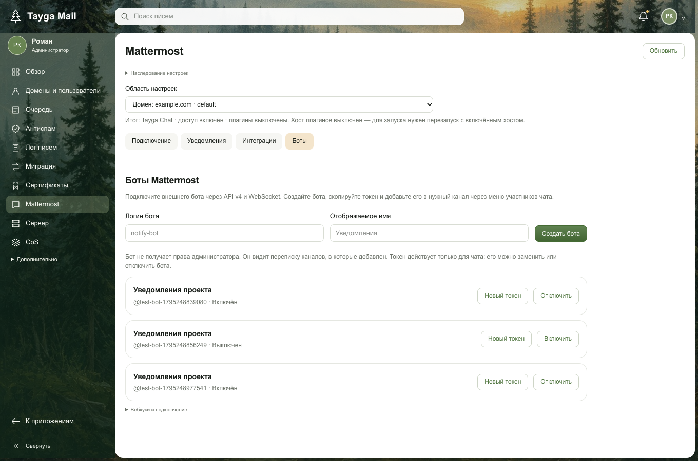

# Подключение ботов Mattermost

Tayga 1.0.2 позволяет подключать внешние программы через Mattermost-совместимые REST API v4 и WebSocket. Программа бота работает отдельно: на вашей машине, сервере или в контейнере. Создание учётной записи не запускает код бота внутри Tayga.

## Создание и доступ

1. Откройте **Администрирование → Mattermost → Боты** и выберите область конкретного домена.
2. Укажите уникальный логин, например `notify-bot`, и отображаемое имя. Логин занимает адрес в этом домене; существующего пользователя заменить ботом нельзя.
3. Нажмите **Создать бота** и скопируйте токен из открывшегося окна. Токен показывается только один раз. На сервере хранится его SHA-256, в браузерное хранилище он не записывается.
4. В нужном чате выберите **Участники → Добавить участника**, найдите бота по имени и добавьте его. В закрытом канале это делает создатель канала. Автоматического вступления бота в общий канал нет.
5. Передайте программе адрес сервера (например `https://mail.example.com`), токен и ID канала.



Бот получает сообщения доступных ему каналов и может отвечать, открывать личный диалог, загружать и скачивать вложения. Он не получает права администратора, не меняет состав каналов и не создаёт другие учётные данные или вебхуки. Токен не подходит для почты, IMAP, SMTP или общего API Tayga. Управлять ботами может администратор выбранной области; отключение владельца учётной записи блокирует его токены ботов.

**Новый токен** сразу заменяет предыдущий. **Отключить** блокирует запросы; открытый WebSocket проверяет авторизацию на событиях/heartbeat. **Включить** восстанавливает доступ с текущим токеном. При утечке сначала отключите бота, замените токен, обновите конфигурацию программы и включите бота.

## REST API и события

Проверка подключения (токен задайте в переменной окружения программы):

```sh
curl --fail --silent --show-error \
  -H "Authorization: Bearer $MATTERMOST_BOT_TOKEN" \
  "$MATTERMOST_URL/api/v4/users/me"
```

Отправка сообщения:

```sh
curl --fail --silent --show-error \
  -H "Authorization: Bearer $MATTERMOST_BOT_TOKEN" \
  -H 'Content-Type: application/json' \
  --data '{"channel_id":"CHANNEL_ID","message":"Сборка завершена"}' \
  "$MATTERMOST_URL/api/v4/posts"
```

Для событий подключитесь к `wss://mail.example.com/api/v4/websocket`, затем отправьте кадр `authentication_challenge` с токеном в `data.token`. После `hello` слушайте событие `posted`; поле `data.post` содержит JSON-строку сообщения. Не отвечайте на собственные сообщения, чтобы избежать бесконечного цикла. После переподключения сверяйте историю через REST API.

Управление учётными записями из программы администратора: `GET/POST /api/v4/bots`, `POST /api/v4/bots/{user_id}/token`, `/enable`, `/disable`. Область задаётся параметрами `tenant_id` и `domain_id`. Создание и замена токена возвращают секрет в поле `token`; список его не содержит. Это интерфейс управления Tayga, не полная реализация Mattermost Personal Access Tokens.

## Входящие вебхуки

Для простых односторонних уведомлений можно использовать существующий `POST /api/v4/hooks/incoming`: пользователь передаёт `channel_id` и `display_name`, получает ID и адрес `https://mail.example.com/hooks/ID`. Отправляйте на этот адрес JSON `{"text":"Уведомление"}`. URL является секретом; он привязан к создателю и одному каналу. Удаление — `DELETE /api/v4/hooks/incoming/ID` от имени создателя. Внешний бот не может выпускать такие URL. Исходящие вебхуки не реализованы; двусторонние интеграции получают события через WebSocket.

Конкретная библиотека может требовать дополнительных методов, которых пока нет в адаптере Tayga. Проверяйте её запросы по [границам совместимости](mattermost-compatibility.md). Базовая модель подключения соответствует [документации Mattermost по API](https://docs.mattermost.com/integrations-guide/restful-api); управление токенами Tayga описано выше.
