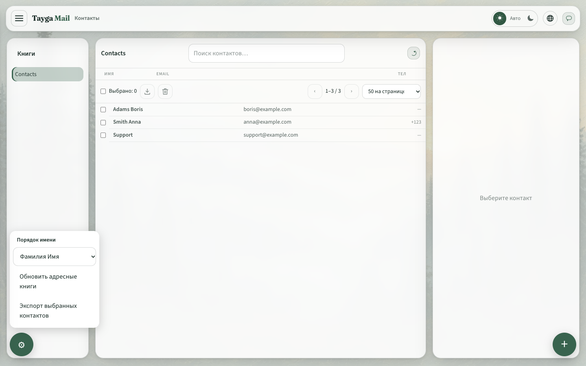
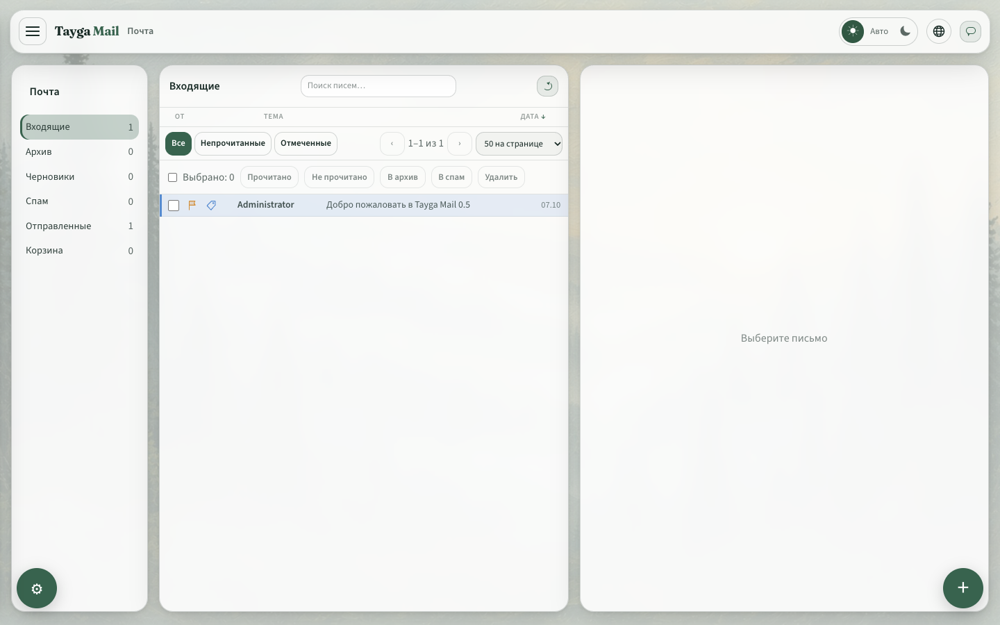

# Tayga Mail 0.9.7

## Почта и контакты

- Флажок у каждого письма, связанный с фильтром «Отмеченные» и стандартным IMAP-флагом `\Flagged`.
- Шесть цветовых меток писем и удаление метки. Цвет сохраняется на сервере как отдельный keyword, не меняя признаки прочтения и флажок.
- Поиск контактов по имени, email, телефону и организации с корректной пагинацией отфильтрованного списка.
- Порядок «Имя Фамилия / Фамилия Имя» в меню шестерёнки. Используются структурированные имена из vCard; если их нет, исходное полное имя сохраняется. Настройка запоминается в браузере отдельно для пользователя.

## FlowSync

- Исправления WBXML, MIME, вложений, подтверждения политики устройства, окон и состояний синхронизации, Ping и SMTP submission.
- EWS получает сведения о версии протокола и служебные контейнеры, запрашиваемые Outlook при обнаружении папок. Дополнительные категории задач, журнала и публичных папок пока доступны только как пустые контейнеры для чтения.
- Сохраняются дополнительные DAV-свойства при изменении события; EWS возвращает поля события и контакта вместо исходного ICS/vCard в теле.
- Журнал содержит запросы и отдельные результаты протокола без паролей и содержимого писем. Поддерживаемые сценарии и ограничения описаны в [совместимости](flowsync-compatibility.md), включение диагностики — в [инструкции](flowsync-debug.md).

FlowSync разработан Кисловым Романом Сергеевичем; модуль имеет отдельную лицензию Apache-2.0. Полная совместимость со всеми функциями Microsoft Exchange не заявляется.

## Проверка

Go-тесты проверяют протокол, состояние синхронизации, границы доступа, отправку писем и сохранение меток. Браузерная проверка охватывает поиск, порядок имён, сохранение флажка и цвета после перезагрузки, а также отсутствие горизонтального переполнения на телефоне.

Перед обновлением сохраните резервную копию базы: миграция 030 добавляет состояние FlowSync. Нагрузочные измерения и стенды предыдущего выпуска остаются в [результатах 0.9.6](release-0.9.6.md); новых чисел производительности в этом выпуске нет.
