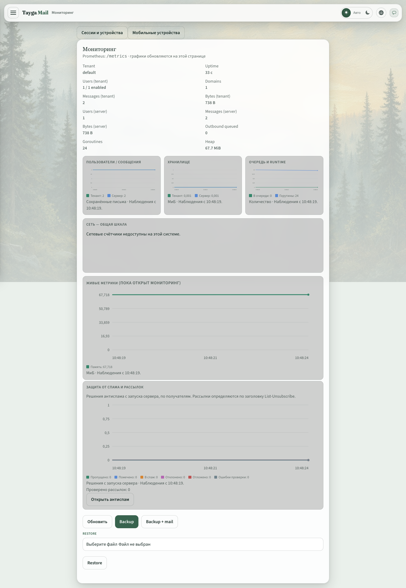
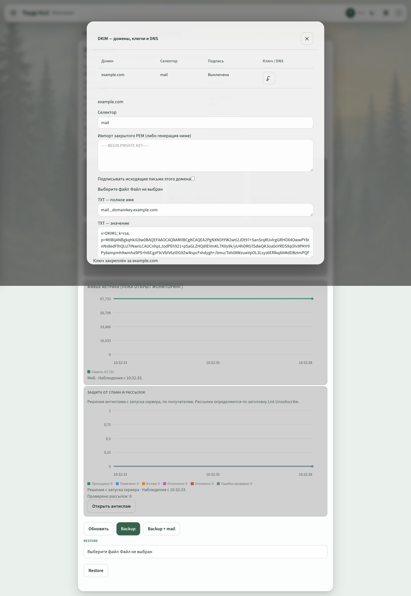
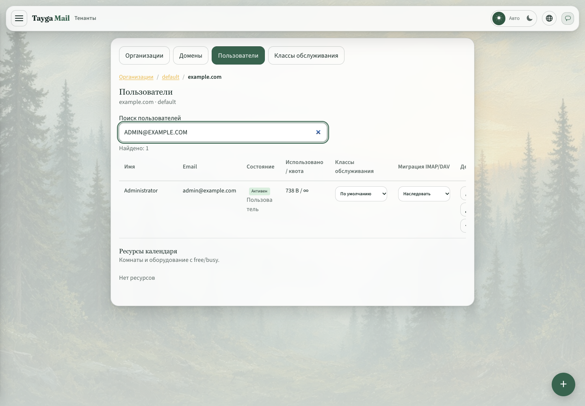

# Tayga Mail 0.9.9

## Администрирование

- Отдельное меню «DKIM — ключи и DNS»: список ключей по доменам, генерация RSA 2048, импорт PEM, привязка к домену, включение подписи и точные значения DNS TXT. Установленный ключ можно скачать отдельно; списки не раскрывают закрытые ключи.
- Подпись SMTP выбирается по домену отправителя; отключённая привязка не подменяется общим ключом. Ошибка чтения активного ключа останавливает приём сообщения временной ошибкой.
- Почтовая очередь вынесена в отдельный раздел с пагинацией. Просмотр, повтор и удаление ограничены доменами администратора; глобальный администратор видит всю очередь.
- Меню «Роли и права» и роль администратора тенанта. В текущей модели организация соответствует тенанту.
- Поиск пользователей по имени и email; таблица сохраняет читаемые адреса и допускает горизонтальную прокрутку.

## Мониторинг и FlowSync

- Временные графики вместо полос: память, очередь, сообщения, объём хранения и решения антиспама. Сетевые RX/TX нескольких интерфейсов Linux отображаются на общей шкале. История накапливается в браузере за последние десять минут.
- Исправлены поля ФИО контактов EWS: имя не подменяется организацией. Ключи версии обновлены для повторной синхронизации контактов.
- Включены изменения после 0.9.7: потоковые уведомления EWS, отображение EWS/ActiveSync в сессиях, удобный формат uptime и локализация стандартных календарей.

FlowSync разработан Кисловым Романом Сергеевичем и лицензируется отдельно по Apache-2.0. Полная совместимость с Microsoft Exchange не заявляется.

## Проверки и ограничения

Серверные тесты проверяют подпись DKIM, импорт PEM, границы доступа к доменам и очереди, а также поля контактов EWS. Браузерная проверка охватывает графики, генерацию ключа, поиск пользователей, роли и отдельную очередь.

Поиск GAL и помещений Outlook, задачи из флажков и управление Sieve через серверные правила Outlook остаются в плане доработок. Серверные тесты не заменяют проверку полного цикла в конкретной версии Outlook.

Перед обновлением сохраните базу, конфигурацию, исполняемый файл и закрытые DKIM-ключи. Каталог `dkim-keys` рядом с корнем mailstore следует резервировать отдельно: существующий веб-экспорт резервной копии его не включает. Подробнее: [управление почтой](admin-mail-tools.md), [совместимость FlowSync](flowsync-compatibility.md).

