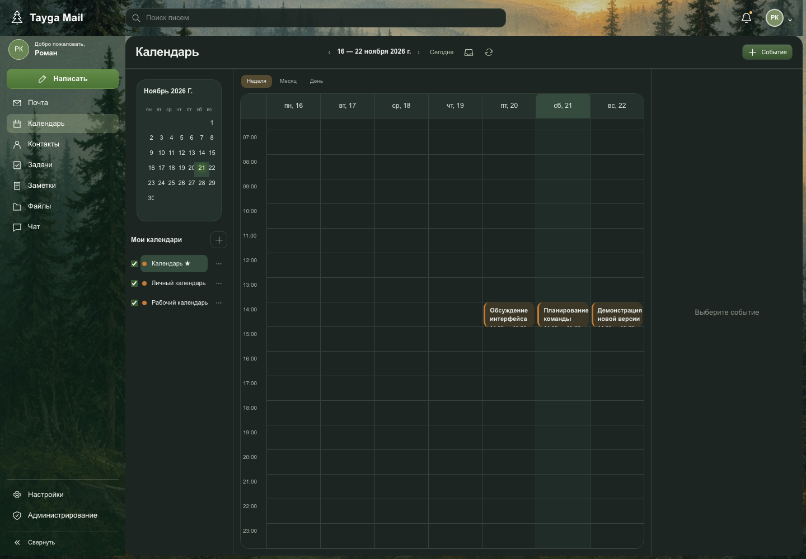

# Tayga Mail Server 1.0.5

## Русский

Статусы участников календаря теперь отображаются значками: зелёная галочка — принял, жёлтый вопрос — ожидает ответа или ответил «под вопросом», красный крестик — отклонил. Точное значение остаётся в подсказке и доступно программе чтения с экрана. Повторяющийся адрес участника убран. Проверены светлая и тёмная темы, ширина экрана 320–1440 px.

Исправлена тёмная тема: мини-календарь, шапка расписания, выбранные дни и панели вложений используют общую палитру. Сохранённый акцентный цвет больше не перекрывает контрастные цвета тёмной темы. Поиск и кнопки календаря остаются читаемыми.

Добавлены DEB и RPM для amd64/arm64, служба systemd, отдельный системный пользователь, сохранение конфигурации и данных при обновлении/удалении. Архивы для Linux, macOS, Windows и FreeBSD остаются доступны. Первый запуск выполняется администратором после настройки; пароля по умолчанию в пакетах нет.

Logrotate: ежедневная ротация, 14 архивов, `maxsize 100M`, отложенное сжатие, права 0640. SIGHUP переоткрывает журнал без остановки сервера; `copytruncate` не используется. Сохранение записей при конкурентной записи и обработка ошибок переоткрытия покрыты тестами.

[Установка пакетов и матрица ОС](https://github.com/rkislov/tayga-mail-server/blob/v1.0.5/docs/linux-packages.md). Переход с установки из архива требует отдельного переноса путей и службы; существующие данные автоматически не перемещаются.

Проверка пакетов охватывает Ubuntu 20.04/22.04/24.04/26.04/26.10, ALT p10/p11, CentOS Stream 9/10, РЕД ОС 7.3/8 и Astra Linux 1.7/1.8; дополнительно Ubuntu 24.04 и ALT p11 на ARM64 и жизненный цикл службы под systemd. Это проверки установки и приложения, без сертификации ОС и мандатных политик.

## English

Calendar attendees now show a green check for accepted, an amber question mark for pending/tentative, and a red cross for declined. Tooltips and screen-reader labels preserve the exact status. Duplicate email labels are removed; light/dark themes and 320–1440 px layouts were checked.

Dark mode now uses consistent surfaces for the mini-calendar, schedule header, selected dates and attachment panels. Saved accent colors no longer override dark-mode contrast; search and calendar controls stay readable.

Native amd64/arm64 DEB and RPM packages add a systemd service, dedicated account, configuration preservation and retained data on removal. Existing Linux, macOS, Windows and FreeBSD archives remain available. Fresh packages do not start automatically or contain a default administrator password.

Logrotate uses daily rotation, 14 archives, a 100 MiB threshold checked on scheduler runs, delayed compression and 0640 permissions. SIGHUP reopens logs without restarting the server or using copytruncate. Concurrent rotation and reopen failures are tested.

[Package installation and OS coverage](https://github.com/rkislov/tayga-mail-server/blob/v1.0.5/docs/linux-packages.md). Archive-based installations require an explicit migration before switching to native packages.

Package checks cover Ubuntu 20.04/22.04/24.04/26.04/26.10, ALT p10/p11, CentOS Stream 9/10, RED OS 7.3/8 and Astra Linux 1.7/1.8, plus Ubuntu 24.04 / ALT p11 ARM64 and a real systemd lifecycle. These are application/package checks, not OS certification or mandatory access-control validation.
