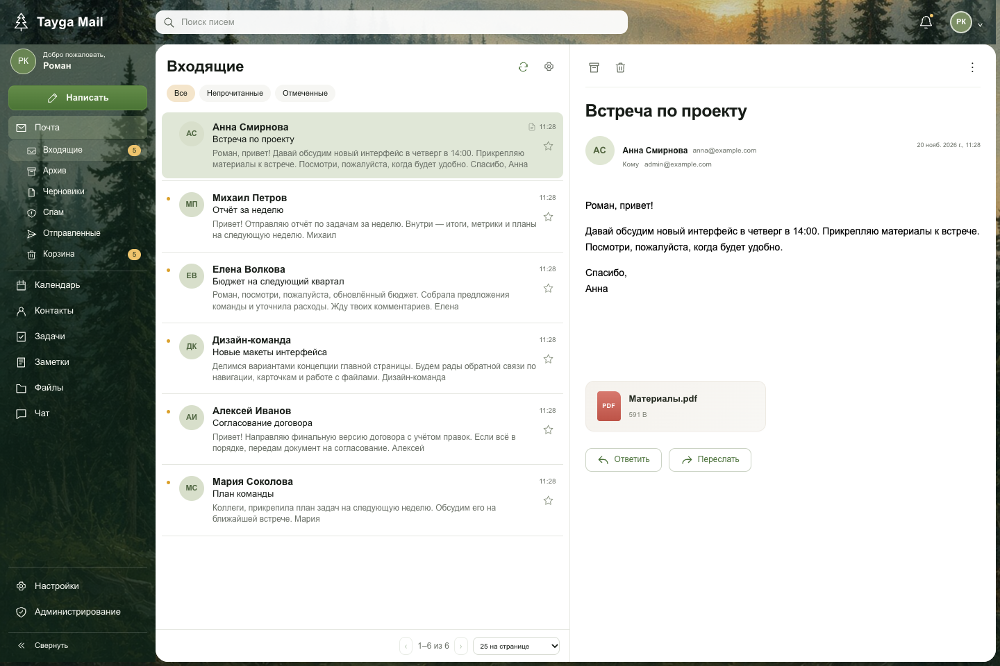
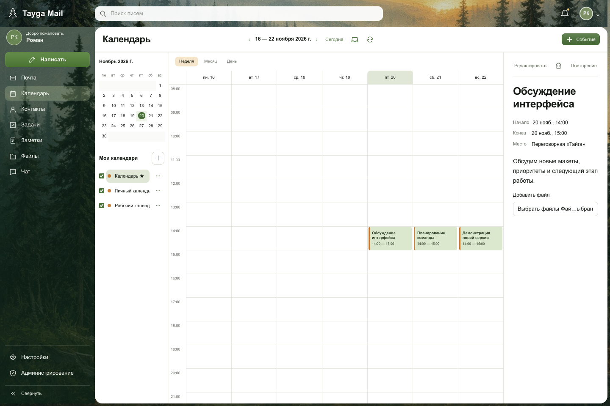
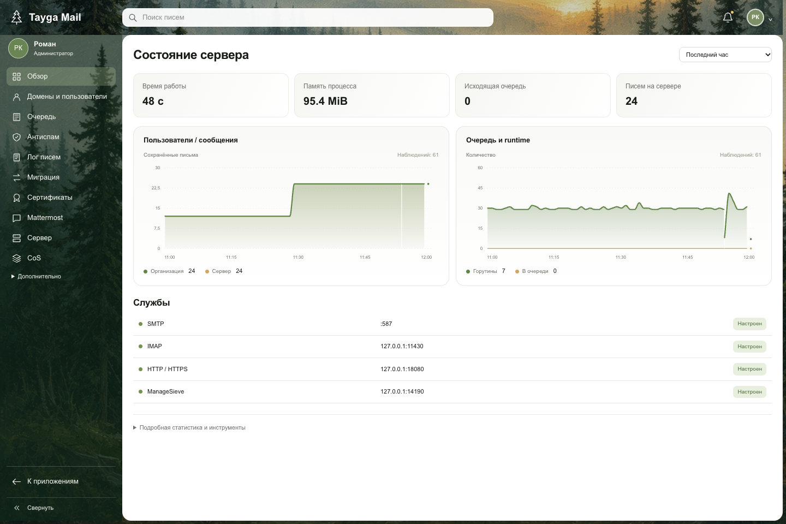
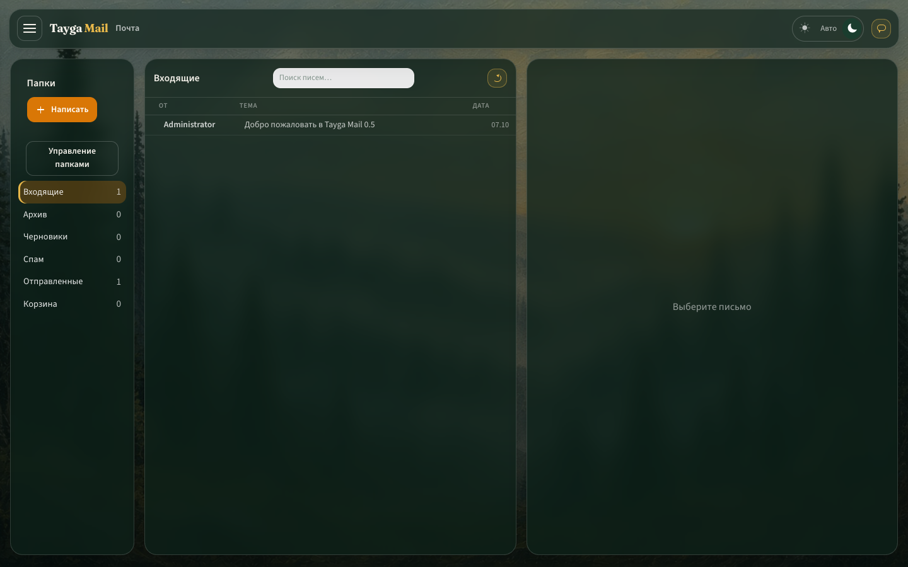
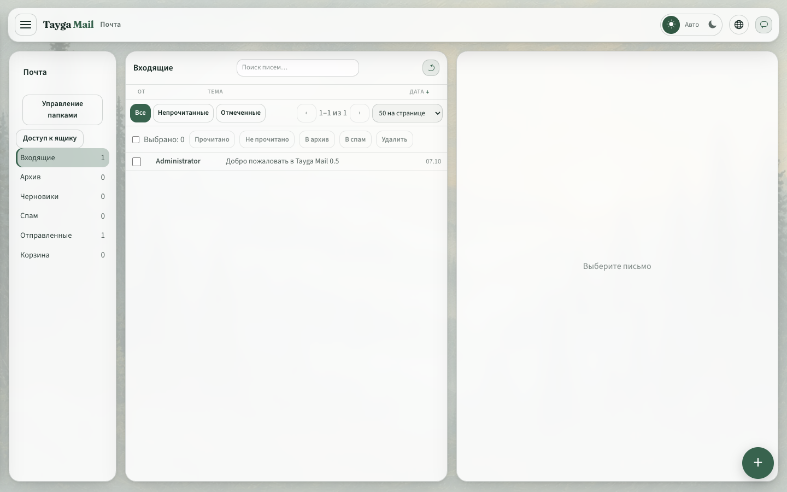
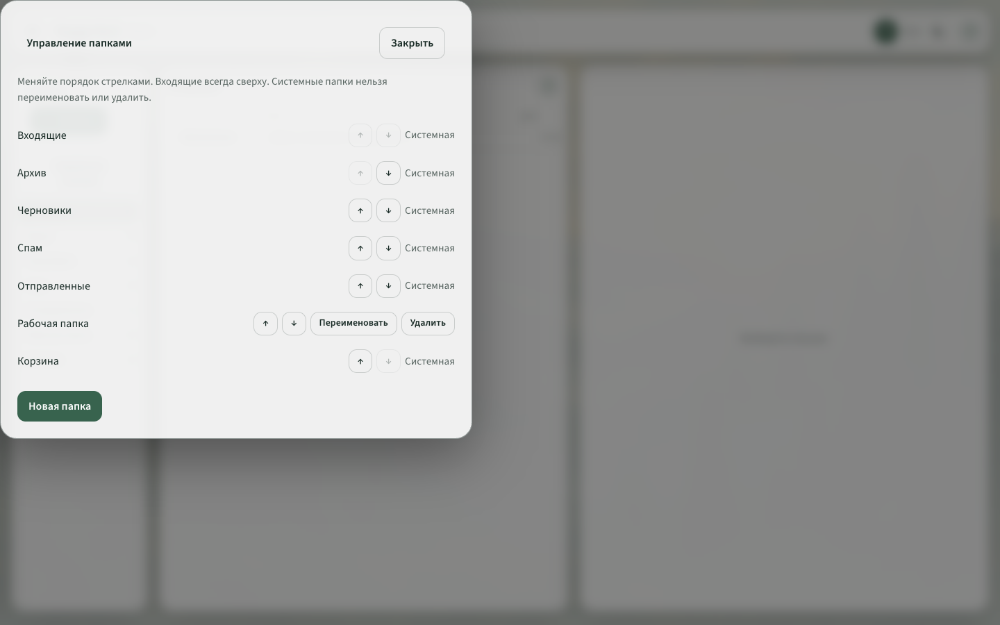
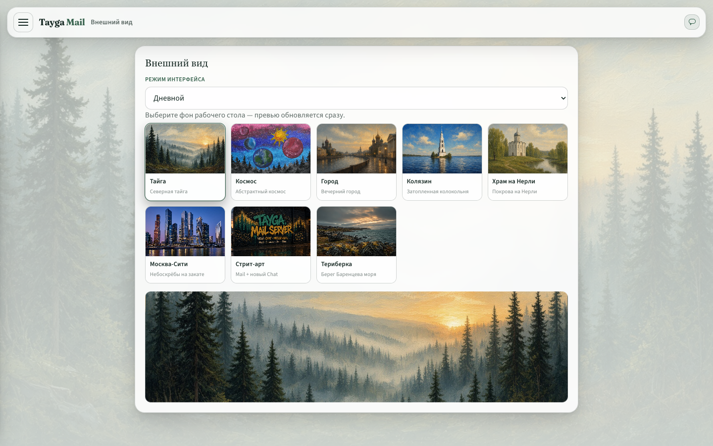
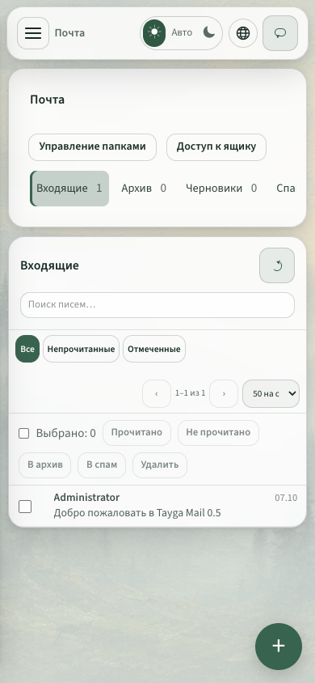

# Интерфейс Tayga Mail

## Личное пространство 1.0.0

Актуальные скриншоты работающего приложения. Изображения сняты на отдельной локальной установке с демонстрационными данными example.com. Публикуемые изображения не являются сгенерированными макетами и не содержат данных рабочего сервера.

- [Вход](v1.0.0/login.png)
- [Почта](v1.0.0/mail.png), [меню до иконок](v1.0.0/mail-compact.png), [создание письма](v1.0.0/compose.png)
- [Календарь](v1.0.0/calendar.png), [контакты](v1.0.0/contacts.png), [задачи](v1.0.0/tasks.png)
- [Заметки](v1.0.0/notes.png), [файлы](v1.0.0/files.png), [Mattermost](v1.0.0/chat.png)
- [Профиль](v1.0.0/profile.png), [внешний вид](v1.0.0/appearance.png), [язык](v1.0.0/language.png), [почтовые фильтры](v1.0.0/filters.png)
- [Обзор сервера](v1.0.0/monitor.png), [очередь](v1.0.0/outbound.png), [журнал доставки](v1.0.0/maillog.png), [антиспам](v1.0.0/antispam.png)
- [Организации](v1.0.0/tenants.png), [домены](v1.0.0/domains.png), [пользователи](v1.0.0/users.png), [сертификаты](v1.0.0/tls.png)
- [Администрирование Mattermost](v1.0.0/mattermost.png), [сервер](v1.0.0/server.png), [форма SMTP](v1.0.0/server-smtp.png), [CoS](v1.0.0/cos.png), [миграция](v1.0.0/migration.png)
- [Мобильная почта](v1.0.0/mobile-mail.png), [мобильное меню](v1.0.0/mobile-navigation.png), [тёмный режим](v1.0.0/mail-dark.png)







[Руководство пользователя](../user-guide.md) · [Руководство администратора](../admin-guide.md).

Снять галерею повторно на отдельном тестовом сервере. Требуются Node.js, установленный `playwright-core` и Chromium/Chrome (путь можно задать через `CHROME_PATH`). Учётную запись стенда задают `TMS_EMAIL` и `TMS_PASSWORD`:

```sh
TMS_URL=http://127.0.0.1:18080 TMS_CAPTURE_SCREENSHOTS=1 node scripts/check-personal-space.mjs
```

## Предыдущие версии интерфейса

# Скриншоты Tayga Mail

Коллекция показывает интерфейс с парящими панелями, скруглёнными краями и дневным/ночным режимом.

## Почта

Ночной режим:



Дневной режим:



Управление папками — перевод системных названий, закреплённые «Входящие», порядок и пользовательские папки:



- [Управление папками на телефоне](ui-mail-folders-tayga-light-mobile.png)

## Внешний вид



## Мобильный интерфейс



- [Мобильная почта — ночной режим](ui-mail-tayga-mobile.png)
- [Мобильное меню](ui-navigation-tayga-mobile.png)
- [Написание письма — дневной режим](ui-compose-tayga-light.png)
- [Компактная форма события](ui-event-editor-tayga-light.png)
- [Компактная форма контакта](ui-contact-editor-tayga-light.png)
- [DKIM: генератор ключей и DNS](ui-dkim-generator-tayga-light.png)

## Настройки администратора и календарь

- [Форма SMTP — дневной режим](ui-settings-smtp-tayga-light.png)
- [Форма SMTP — ночной режим](ui-settings-smtp-tayga.png)
- [Расписание дня](ui-calendar-day-tayga-light.png)
- [Лоток приглашений](ui-calendar-invites-tayga-light.png)

## Классы обслуживания и миграция

- [Форма класса обслуживания](ui-cos-editor-tayga-light.png)
- [Форма класса обслуживания на телефоне](ui-cos-editor-tayga-light-mobile.png)
- [Выбор типа переноса](ui-migration-tayga-light.png)
- [Параметры переноса почты](ui-migration-dialog-tayga-light.png)

## Остальные экраны

Для календаря, контактов, заметок, файлов, чата и административных разделов доступны ночные `ui-*-tayga.png` и дневные `ui-*-tayga-light.png` версии. Также сохранены примеры фонов «Космос», «Москва-Сити», «Стрит-арт» и «Териберка».

## Обновление

Соберите frontend (`npm run build --prefix frontend`) и сервер, затем запустите сервер с тестовыми данными. Скрипт использует отдельную браузерную сессию и seed-аккаунт `admin@example.com` / `changeme`.

```bash
node scripts/capture-screenshots.mjs
```

По умолчанию сервер доступен на `http://127.0.0.1:18080`. Переменные `TMS_URL` и `CHROME_PATH` позволяют указать другой адрес сервера и путь к Chromium/Chrome.

Размер настольных снимков — 1440 × 900, мобильных — 390 × 844. Скрипт обновляет существующие PNG и создаёт дневные и мобильные варианты.

## Обновлённые действия

- [Свойства календаря и публичная подписка](ui-calendar-properties-tayga-light.png)
- [Свойства календаря на телефоне](ui-calendar-properties-tayga-light-mobile.png)
- [Контекстное меню файлов и ZIP папки](ui-files-context-tayga-light.png)
- [Настройки XMPP по разделам](ui-xmpp-tayga-light.png)

## Редактор заметок

- [Текст, списки и компактные вложения](ui-notes-editor-tayga-light.png)
- [Длинная заметка и вложения на телефоне](ui-notes-editor-tayga-light-mobile.png)

Эти снимки обновляет `node scripts/check-notes-editor.mjs` на временном тестовом сервере.

## Календарь и статусы чата — октябрь 2026

Локальный стенд с тестовыми календарями и фикстурами списка контактов/статусов; реальные учётные записи не используются.

- [Расширенная колонка календарей](ui-calendar-wide-202610.png)
- [Кнопки свойств календарей на телефоне](ui-calendar-mobile-202610.png)
- [Меню статуса чата](ui-chat-presence-202610.png)
- [Меню статуса на телефоне](ui-chat-presence-mobile-202610.png)

## Обновление 1.0.1

Снимки работающего интерфейса на локальном демонстрационном стенде.

- [Чаты и вложения](v1.0.1/chat.png)
- [Чтение письма](v1.0.1/mail.png)
- [Неделя](v1.0.1/calendar-week.png) и [день](v1.0.1/calendar-day.png)
- [Файлы](v1.0.1/files.png)
- [Антиспам](v1.0.1/antispam.png)
- [Подробный статус доставки](v1.0.1/delivery-status.png)

## Уточнения интерфейса 1.0.2

Скриншоты работающего приложения с демонстрационными данными:

- [Делегирование](v1.0.2/delegation.png)
- [Составление письма и адресная книга](v1.0.2/compose.png)
- [Почтовые фильтры](v1.0.2/filters.png)
- [Сохранение правила](v1.0.2/rule-editor.png)

### Мобильный чат и боты в 1.0.2

Снимки работающего приложения с демонстрационными данными:

- [Список чатов на телефоне](v1.0.2/chat-mobile.png)
- [Переписка на телефоне](v1.0.2/chat-mobile-thread.png)
- [Управление ботами Mattermost](v1.0.2/bots.png)
