# Руководство пользователя Tayga Mail 1.0.1

Tayga Mail объединяет почту, календарь, контакты, задачи, заметки, файлы и чат Mattermost в личном пространстве. В интерфейсе нет рекламных блоков. Скриншоты ниже сняты с работающего приложения на отдельном локальном стенде с демонстрационными данными; это не изображения будущих функций.

## Вход и главное меню

Откройте адрес, выданный администратором, введите полный email и пароль. Если включён второй фактор, завершите вход выбранным способом. При недоступном входе обратитесь к администратору своей организации.

Слева находятся приложения и кнопка «Написать». Внизу меню — настройки; у администратора дополнительно есть переход в административное пространство. Кнопка «Свернуть» уменьшает меню до иконок. Выбор сохраняется в браузере. Наведите указатель на иконку или перейдите к ней клавишей Tab, чтобы увидеть название. На телефоне меню открывается кнопкой в шапке; Escape и нажатие на затемнённую область закрывают его.

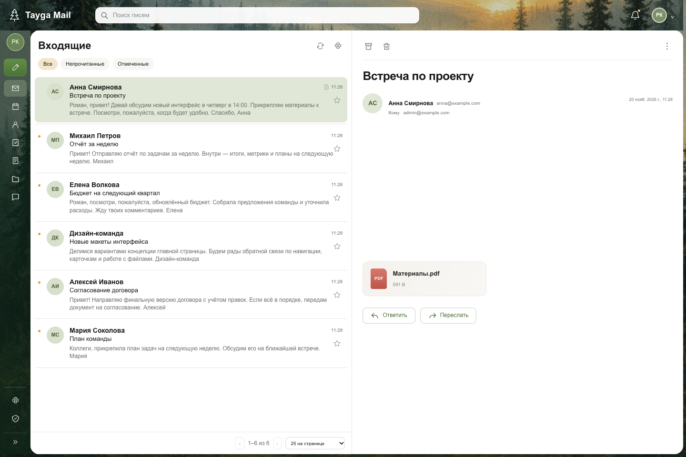

Меню пользователя открывается нажатием на аватар справа в шапке. Там доступны профиль, видеоконференции, перенос данных и выход из учётной записи.

## Почта

По умолчанию на странице показано до 25 писем; внизу списка можно выбрать 50 или 100. Папки почты находятся в левом меню. Непрочитанные письма обозначены точкой, количество показано рядом с папкой. Откройте письмо в списке: его содержимое появится справа. Звёздочка отмечает письмо; быстрые фильтры показывают все, непрочитанные или отмеченные письма. Поиск в шапке открывает результаты в разделе почты.

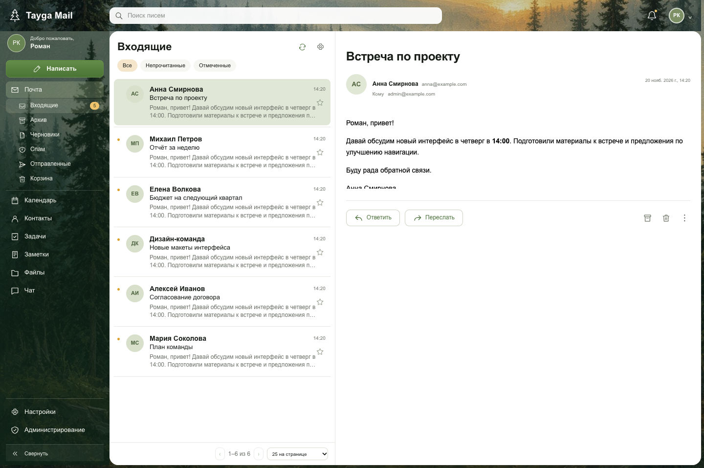

Наведите указатель на строку письма или перейдите в неё с клавиатуры, чтобы увидеть флажок выбора. После выбора появляется панель групповых действий. Архивирование, перемещение в спам и удаление выполняются для выбранных писем. При частичной ошибке приложение сообщает результат и оставляет доступные необработанные письма выделенными.

Кнопки «Ответить» и «Переслать» находятся под письмом. Дополнительные действия доступны в меню «⋮». Внешние изображения загружаются с учётом ваших настроек безопасности; встроенные изображения и вложения обрабатываются отдельно. Карточка вложения открывает предпросмотр поддерживаемого формата, откуда файл можно скачать.

### Создание письма

Нажмите «Написать». Редактор открывается внутри рабочего пространства. Выберите отправителя, укажите получателя и тему. При необходимости добавьте копию. Визуальный редактор поддерживает форматирование, списки, ссылки, изображения и таблицы. Для изображения используйте загрузку на панели редактора, затем измените его размер в письме.

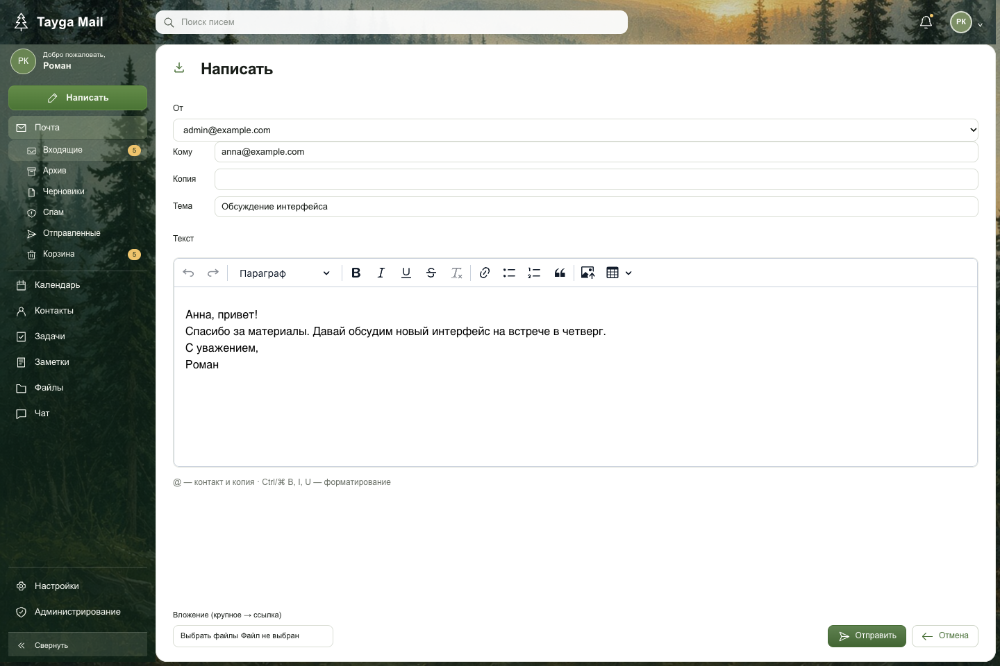

Файлы можно приложить к письму. Большие вложения отправляются ссылкой, если это разрешено настройками сервера. Дождитесь завершения загрузки перед отправкой. Автоматическая подпись настраивается в профиле. Доступные адреса отправителя определяются серверными правами; делегированные ящики и отправка от имени другого пользователя требуют разрешения владельца или администратора. Подробности — [делегирование](delegation.md).

## Календарь

В календаре по умолчанию показано расписание недели. Слева находится мини-календарь и список ваших календарей; флажки включают и выключают показ их событий. Доступны виды недели, месяца и дня. Стрелки перемещают отображаемый период, кнопка «Сегодня» возвращает текущую дату.

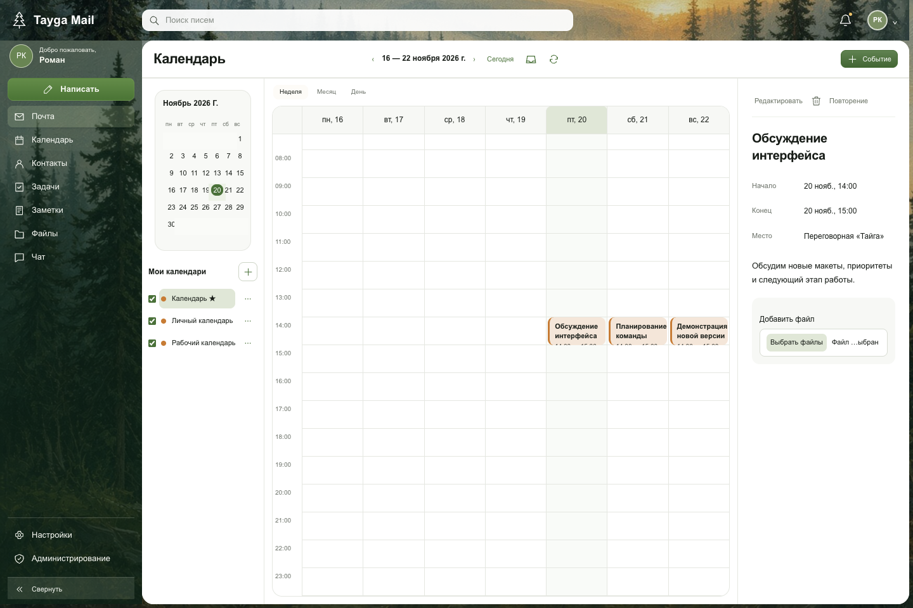

Режим «День» использует такую же часовую сетку. Двойной щелчок по свободному времени открывает создание события на этот час.

Нажмите «Событие» или дважды нажмите свободное место в расписании. Укажите название, начало и конец, место, участников и описание. Сохраните событие. Для приглашённых участников сервер обрабатывает приглашения и ответы; поведение внешних клиентов зависит от поддерживаемых ими протоколов. Откройте событие, чтобы просмотреть сведения справа. Входящие приглашения доступны кнопкой в шапке календаря. Подробности — [приглашения и согласование времени](calendar-scheduling.md).

## Контакты

Выберите адресную книгу слева, найдите контакт по имени или адресу и откройте его карточку. Справа показаны сохранённые контактные сведения. «Написать» открывает письмо этому контакту, «Изменить» — форму редактирования. Для нового контакта используйте кнопку в шапке. Контакты из справочника организации могут быть доступны только для чтения.

Справочник подразделений и групп, если он доступен вашей организации, открывается отдельным действием. Его состав и возможность изменения определяет администратор. Подробнее — [оргструктура](organization-directory.md).

## Задачи

Список задач находится слева, сведения о выбранной задаче — справа. Флажок завершает доступную для изменения задачу; кнопка в карточке делает то же действие. Откройте редактирование, чтобы изменить описание, срок, состояние и процент выполнения. Переключатель над списком включает завершённые задачи.

Назначение исполнителя, принятие, отклонение и отзыв назначения зависят от ваших прав. Уведомления и история изменений доступны в соответствующих блоках. Для задач, пришедших из внешнего клиента или повторяющейся серии, набор разрешённых действий может отличаться.

## Заметки

Выберите папку и заметку. Справа находится заголовок и редактор с форматированием, списками и чек-листами. Состояние сохранения показано возле редактора. Перед закрытием убедитесь, что изменения сохранены. При конфликте версий приложение предлагает сохранить свой текст отдельно, загрузить серверную версию или явно заменить её.

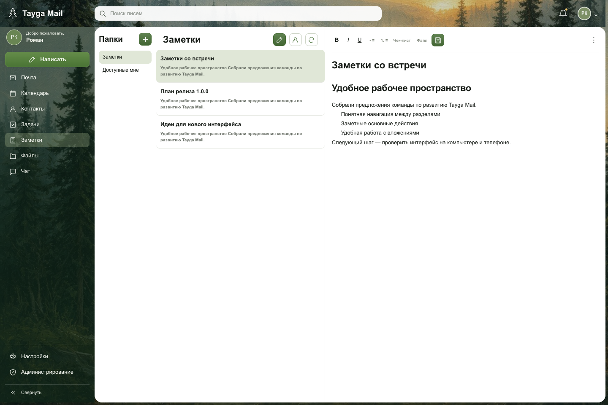

Файлы, рисунок, общий доступ и история версий доступны на панели заметки и в меню дополнительных действий. Восстановление прошлой версии создаёт новое сохранённое состояние; не заменяйте чужие изменения без проверки.

## Файлы

В шапке раздела находятся текущий путь, создание папки и загрузка. Навигация слева открывает личные файлы, общие пространства, поиск, корзину и сведения о WebDAV. Нажмите файл в таблице, чтобы увидеть его карточку справа. Для поддерживаемых изображений и PDF доступен предпросмотр.

Меню «⋯» строки содержит действия с файлом или папкой. Права общего пространства определяются группами организации. Карточка доступа показывает прямые и унаследованные разрешения; изменить унаследованное разрешение может потребоваться на уровне родительской папки или пространства. Публичная ссылка может иметь срок действия, пароль и ограничение скачиваний. Получатели видят только то, что разрешено этой ссылкой.

Корзина и версии позволяют восстановить данные в пределах настроенной политики хранения. Для офисного редактирования администратор должен подключить соответствующий офисный сервис. Подробнее — [файлы и офис](files-and-office.md).

Высота письма подстраивается под содержимое; действия находятся внизу письма. Сворачивание левого меню расширяет область чтения. В карточке файла основные действия расположены сверху, дополнительные доступны через «⋮».

## Mattermost и видеоконференции

Раздел «Чат» показывает каналы и личные сообщения Mattermost. Выберите канал слева: сообщения и поле ввода появятся справа. Можно создать диалог, создать доступный вам канал или присоединиться к открытому каналу организации. Права закрытых каналов проверяет сервер.

Аватар или инициалы показываются рядом с участниками и сообщениями. Под своим именем выберите статус: «В сети», «Отошёл», «Не беспокоить» или «Не в сети». Кнопки нового диалога, создания и поиска каналов, участников, звонка и ответа представлены иконками; наведите указатель или перейдите клавишей Tab для доступа к подписанным действиям.

Скрепка у поля ввода прикрепляет файлы. Можно перетащить файлы в поле ввода или вставить изображение из буфера. До отправки вложение можно убрать крестиком. Допускается до пяти файлов общим размером до 1 ГиБ, в том числе без текста сообщения. В истории показываются изображения и карточки документов со значком формата, именем, размером и скачиванием. Большие изображения доступны для скачивания без автоматического превью.

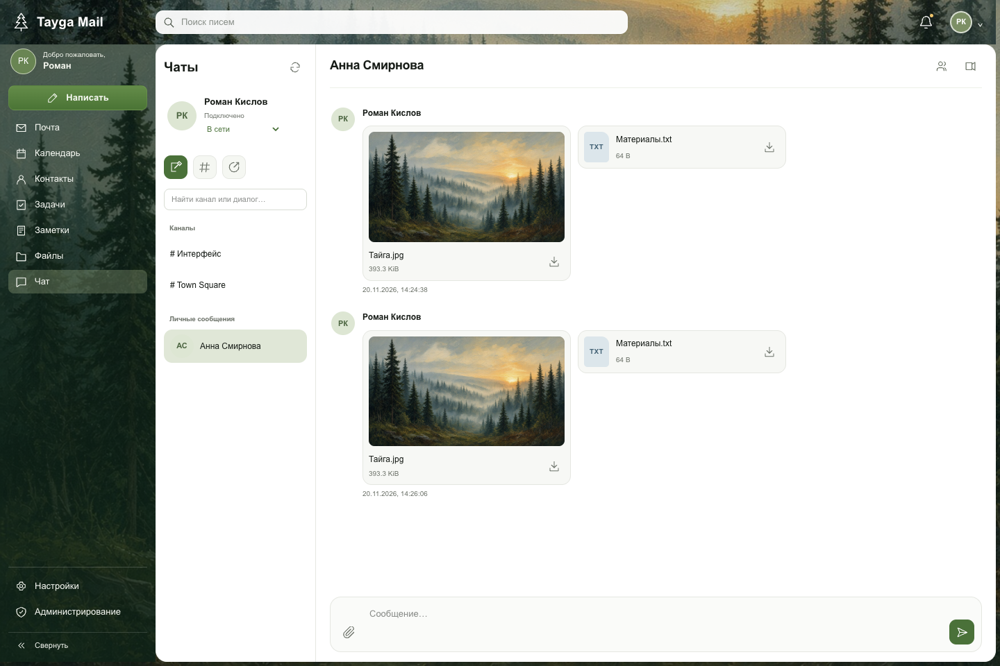

Видеоконференции доступны из меню пользователя и из чата, если они включены администратором. Ссылка на встречу Jitsi открывается в предусмотренном сервисе. Политики Mattermost, фоновые уведомления и интеграции зависят от конфигурации установки. Поддерживаемые функции и ограничения описаны в [совместимости Mattermost](mattermost-compatibility.md) и [видеоконференциях](vks.md).

## Профиль, безопасность и внешний вид

В «Настройки» изменяются отображаемое имя, фотография профиля и подпись. Там же доступны второй фактор и ключи входа Passkeys. Дополнительные параметры учётной записи, внешние ящики, сессии и перенос данных сгруппированы отдельно. После изменения пароля может потребоваться повторный вход в клиенты.

Во «Внешний вид» выберите светлый, тёмный или системный режим. Выберите рисунок фона, комфортную или компактную плотность списка и акцентный цвет. Эти предпочтения сохраняются в текущем браузере. Другие рисунки доступны в раскрываемом списке фонов. Автор художественных фонов — Алиса Кислова; сведения о лицензиях сохранены в [NOTICE](../NOTICE).

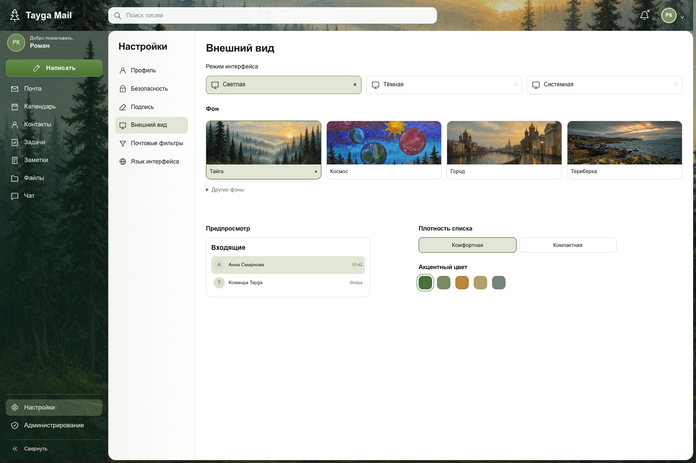

В разделе языка доступны русский и английский. Почтовые фильтры и автоответчик настраиваются в соответствующем разделе; подробнее — [настройка фильтров](setup-filters.md). Фильтр может перемещать входящие письма автоматически, поэтому проверьте условия на понятном примере перед включением.

## Телефон и клавиатура

На узком экране список и выбранная запись показываются последовательно. Кнопка возврата в рабочей панели возвращает список. Tab перемещает фокус между действиями, Enter активирует кнопку, Escape закрывает меню или диалог, если действие не находится в процессе сохранения. Скрытое мобильное меню недоступно для фокуса, пока вы его не откроете.

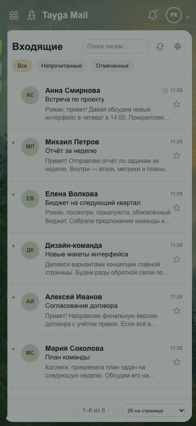

## Если что-то не работает

Проверьте сообщение возле действия и соединение с сервером. При сообщении о недостаточных правах обратитесь к владельцу данных или администратору. При ошибке отправки уточните результат в папке отправленных перед повтором. Для обращения к администратору сообщите время, раздел и текст ошибки; не отправляйте пароль, резервные коды и секретные ссылки.

## Уточнения интерфейса 1.0.2

Действия над открытым письмом закреплены сверху и остаются доступны при прокрутке. Иконки массовой обработки имеют подсказки при наведении и доступные названия.

В полях «Кому» и «Копия» кнопка с силуэтом открывает адресную книгу. Найдите контакт, отметьте одного или нескольких получателей и нажмите «Добавить получателей». Подсказки при вводе ищут по имени и адресу в контактах и справочнике организации. Стрелки выбирают подсказку, Enter вставляет адрес, Escape закрывает список.

Делегирование содержит отдельные группы прав «Почта» и «Календарь». Выберите нужные разрешения и нажмите «Предоставить доступ»; для существующего делегата доступно изменение и отзыв прав.

В конструкторе почтовых правил кнопка «Сохранить и включить» сохраняет правило на сервер сразу. Изменение порядка, удаление и включение правил в общем списке подтверждаются отдельной кнопкой «Сохранить и включить» под списком. Правила Outlook отображаются для справки и управляются из Outlook.

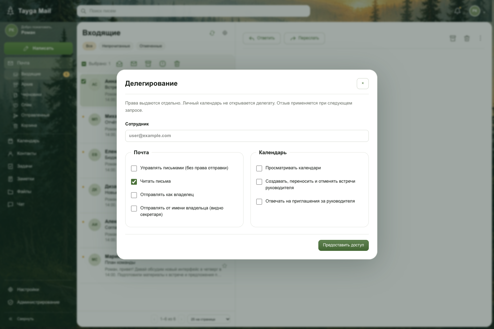

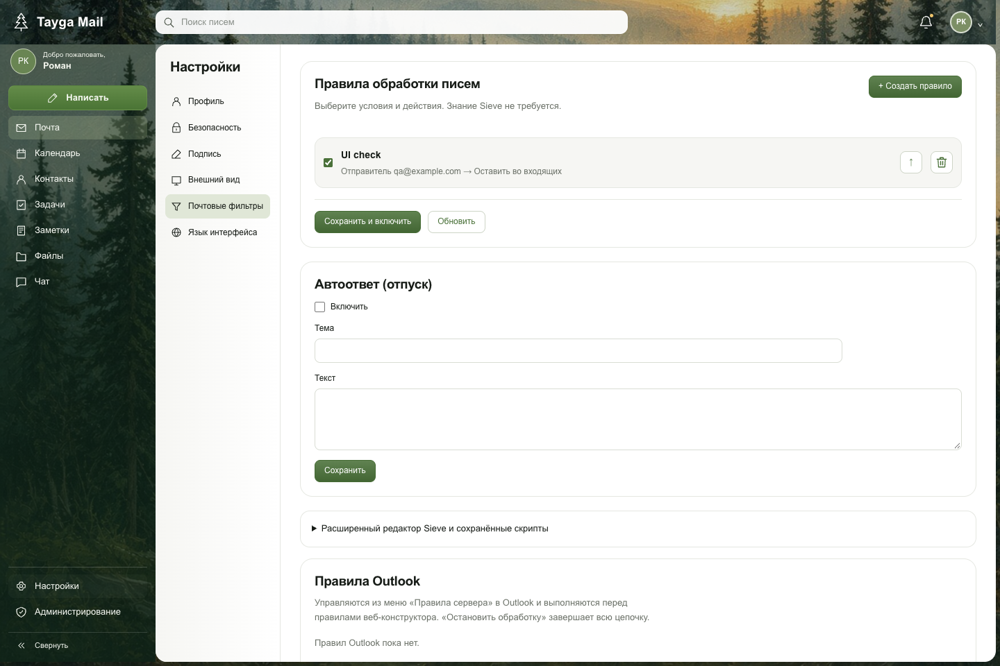

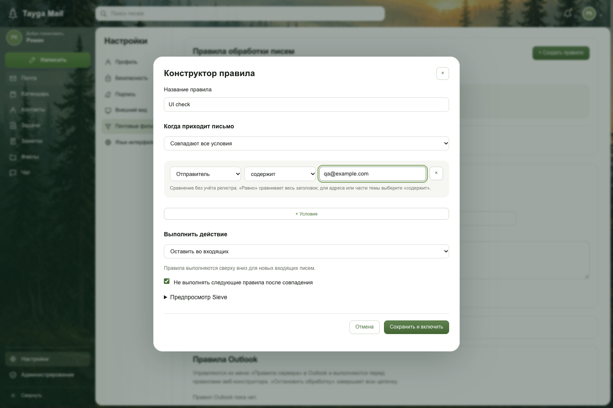
