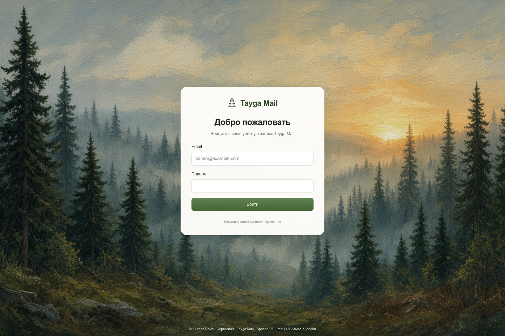
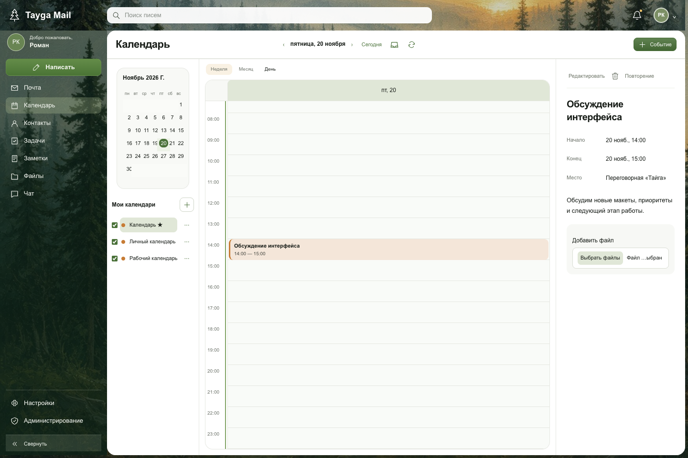
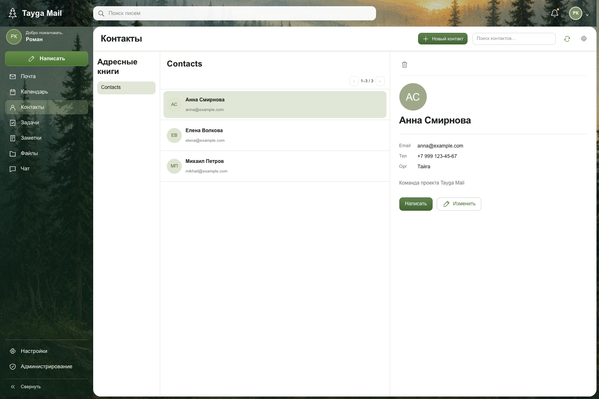
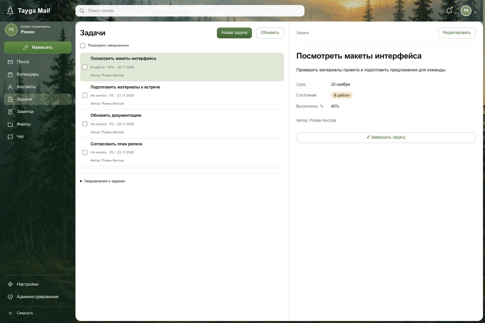
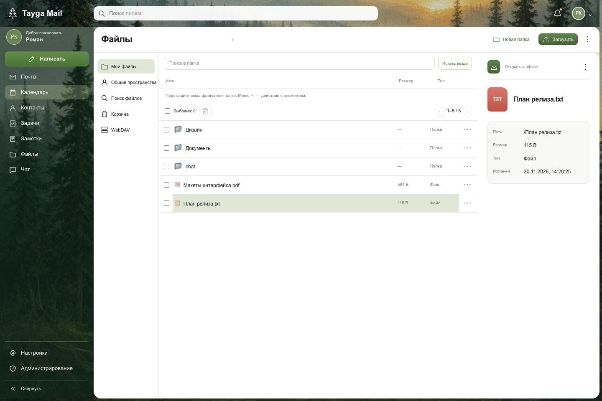
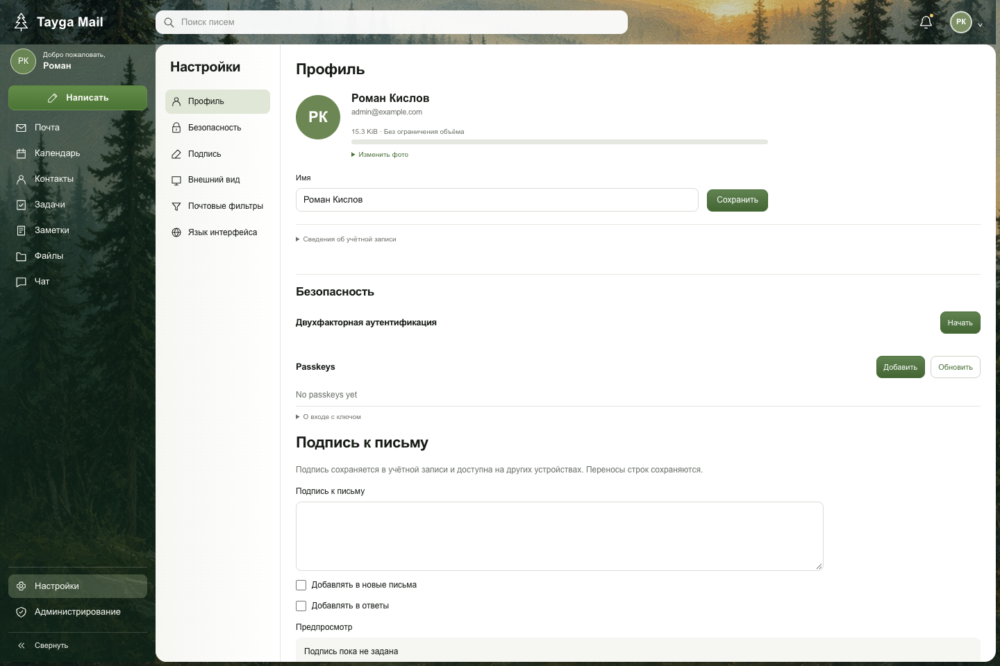
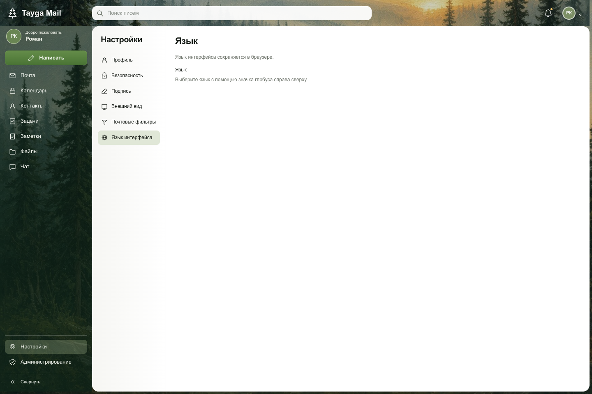
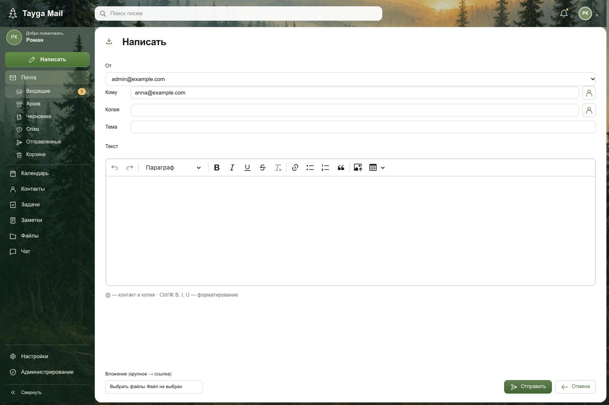
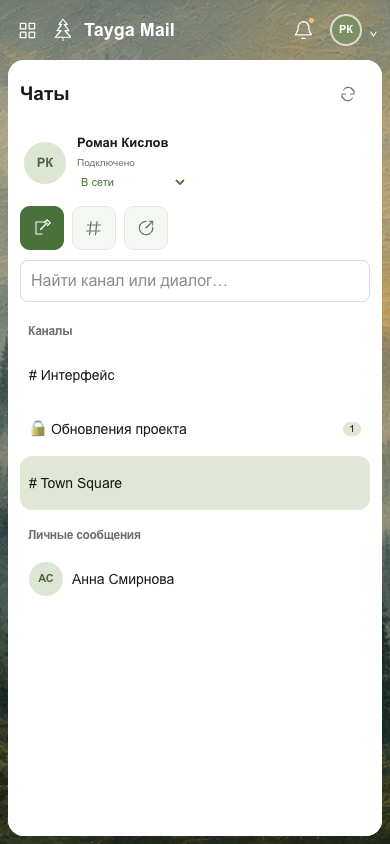
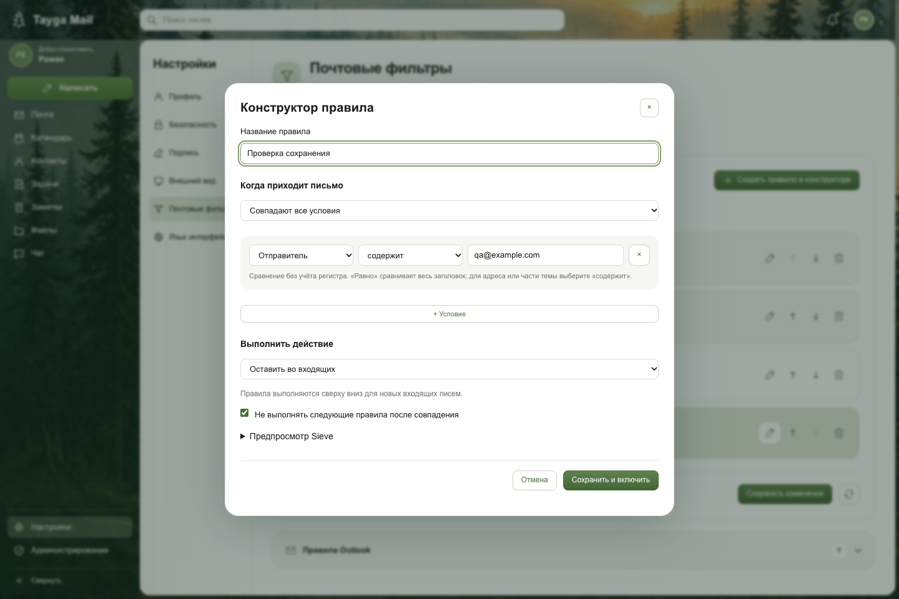

# Руководство пользователя Tayga Mail 1.3.0

Tayga Mail объединяет почту, календарь, контакты, задачи, заметки, файлы и чат Mattermost в личном пространстве. В интерфейсе нет рекламных блоков. Скриншоты ниже сняты с работающего приложения на отдельном локальном стенде с демонстрационными данными; это не изображения будущих функций.

## Вход и главное меню

Откройте адрес, выданный администратором, введите полный email и пароль. Если включён второй фактор, завершите вход выбранным способом. При недоступном входе обратитесь к администратору своей организации.

Слева находятся приложения и кнопка «Написать». Внизу меню — настройки; у администратора дополнительно есть переход в административное пространство. Кнопка «Свернуть» уменьшает меню до иконок. Выбор сохраняется в браузере. Наведите указатель на иконку или перейдите к ней клавишей Tab, чтобы увидеть название. На телефоне меню открывается кнопкой в шапке; Escape и нажатие на затемнённую область закрывают его.

Меню пользователя открывается нажатием на аватар справа в шапке. Там доступны профиль, видеоконференции, перенос данных и выход из учётной записи.

## Почта

По умолчанию на странице показано до 25 писем; внизу списка можно выбрать 50 или 100. Папки почты находятся в левом меню. Непрочитанные письма обозначены точкой, количество показано рядом с папкой. Откройте письмо в списке: его содержимое появится справа. Звёздочка отмечает письмо; быстрые фильтры показывают все, непрочитанные или отмеченные письма. Поиск в шапке открывает результаты в разделе почты.

Наведите указатель на строку письма или перейдите в неё с клавиатуры, чтобы увидеть флажок выбора. После выбора появляется панель групповых действий. Архивирование, перемещение в спам и удаление выполняются для выбранных писем. При частичной ошибке приложение сообщает результат и оставляет доступные необработанные письма выделенными.

Кнопки «Ответить» и «Переслать» находятся под письмом. Дополнительные действия доступны в меню «⋮». Внешние изображения загружаются с учётом ваших настроек безопасности; встроенные изображения и вложения обрабатываются отдельно. Карточка вложения открывает предпросмотр поддерживаемого формата, откуда файл можно скачать.

### Создание письма

Нажмите «Написать». Редактор открывается внутри рабочего пространства. Выберите отправителя, укажите получателя и тему. При необходимости добавьте копию. Визуальный редактор поддерживает форматирование, списки, ссылки, изображения и таблицы. Для изображения используйте загрузку на панели редактора, затем измените его размер в письме.

Файлы можно приложить к письму. Большие вложения отправляются ссылкой, если это разрешено настройками сервера. Дождитесь завершения загрузки перед отправкой. Автоматическая подпись настраивается в профиле. Доступные адреса отправителя определяются серверными правами; делегированные ящики и отправка от имени другого пользователя требуют разрешения владельца или администратора. Подробности — [делегирование](delegation.md).

## Календарь

В календаре по умолчанию показано расписание недели. Слева находится мини-календарь и список ваших календарей; флажки включают и выключают показ их событий. Доступны виды недели, месяца и дня. Стрелки перемещают отображаемый период, кнопка «Сегодня» возвращает текущую дату.

Режим «День» использует такую же часовую сетку. Двойной щелчок по свободному времени открывает создание события на этот час.

Нажмите «Событие» или дважды нажмите свободное место в расписании. Укажите название, начало и конец, место, участников и описание. Сохраните событие. Для приглашённых участников сервер обрабатывает приглашения и ответы; поведение внешних клиентов зависит от поддерживаемых ими протоколов. Откройте событие, чтобы просмотреть сведения справа. Входящие приглашения доступны кнопкой в шапке календаря. Подробности — [приглашения и согласование времени](calendar-scheduling.md).

## Контакты

Выберите адресную книгу слева, найдите контакт по имени или адресу и откройте его карточку. Справа показаны сохранённые контактные сведения. «Написать» открывает письмо этому контакту, «Изменить» — форму редактирования. Для нового контакта используйте кнопку в шапке. Контакты из справочника организации могут быть доступны только для чтения.

Справочник подразделений и групп, если он доступен вашей организации, открывается отдельным действием. Его состав и возможность изменения определяет администратор. Подробнее — [оргструктура](organization-directory.md).

## Задачи

Список задач находится слева, сведения о выбранной задаче — справа. Флажок завершает доступную для изменения задачу; кнопка в карточке делает то же действие. Откройте редактирование, чтобы изменить описание, срок, состояние и процент выполнения. Переключатель над списком включает завершённые задачи.

Назначение исполнителя, принятие, отклонение и отзыв назначения зависят от ваших прав. Уведомления и история изменений доступны в соответствующих блоках. Для задач, пришедших из внешнего клиента или повторяющейся серии, набор разрешённых действий может отличаться.

## Заметки

Выберите папку и заметку. Справа находится заголовок и редактор с форматированием, списками и чек-листами. Состояние сохранения показано возле редактора. Перед закрытием убедитесь, что изменения сохранены. При конфликте версий приложение предлагает сохранить свой текст отдельно, загрузить серверную версию или явно заменить её.

Файлы, рисунок, общий доступ и история версий доступны на панели заметки и в меню дополнительных действий. Восстановление прошлой версии создаёт новое сохранённое состояние; не заменяйте чужие изменения без проверки.

## Файлы

В шапке раздела находятся текущий путь, создание папки и загрузка. Навигация слева открывает личные файлы, общие пространства, поиск, корзину и сведения о WebDAV. Нажмите файл в таблице, чтобы увидеть его карточку справа. Для поддерживаемых изображений и PDF доступен предпросмотр.

Меню «⋯» строки содержит действия с файлом или папкой. Права общего пространства определяются группами организации. Карточка доступа показывает прямые и унаследованные разрешения; изменить унаследованное разрешение может потребоваться на уровне родительской папки или пространства. Публичная ссылка может иметь срок действия, пароль и ограничение скачиваний. Получатели видят только то, что разрешено этой ссылкой.

Корзина и версии позволяют восстановить данные в пределах настроенной политики хранения. Для офисного редактирования администратор должен подключить соответствующий офисный сервис. Подробнее — [файлы и офис](files-and-office.md).

Высота письма подстраивается под содержимое; действия находятся внизу письма. Сворачивание левого меню расширяет область чтения. В карточке файла основные действия расположены сверху, дополнительные доступны через «⋮».

## Mattermost и видеоконференции

Раздел «Чат» показывает каналы и личные сообщения Mattermost. Выберите канал слева: сообщения и поле ввода появятся справа. Можно создать диалог, создать доступный вам канал или присоединиться к открытому каналу организации. Права закрытых каналов проверяет сервер.

Аватар или инициалы показываются рядом с участниками и сообщениями. Под своим именем выберите статус: «В сети», «Отошёл», «Не беспокоить» или «Не в сети». Кнопки нового диалога, создания и поиска каналов, участников, звонка и ответа представлены иконками; наведите указатель или перейдите клавишей Tab для доступа к подписанным действиям.

Скрепка у поля ввода прикрепляет файлы. Можно перетащить файлы в поле ввода или вставить изображение из буфера. До отправки вложение можно убрать крестиком. Допускается до пяти файлов общим размером до 1 ГиБ, в том числе без текста сообщения. В истории показываются изображения и карточки документов со значком формата, именем, размером и скачиванием. Большие изображения доступны для скачивания без автоматического превью.

Видеоконференции доступны из меню пользователя и из чата, если они включены администратором. Ссылка на встречу Jitsi открывается в предусмотренном сервисе. Политики Mattermost, фоновые уведомления и интеграции зависят от конфигурации установки. Поддерживаемые функции и ограничения описаны в [совместимости Mattermost](mattermost-compatibility.md) и [видеоконференциях](vks.md).

## Профиль, безопасность и внешний вид

В «Настройки» изменяются отображаемое имя, фотография профиля и подпись. Там же доступны второй фактор и ключи входа Passkeys. Дополнительные параметры учётной записи, внешние ящики, сессии и перенос данных сгруппированы отдельно. После изменения пароля может потребоваться повторный вход в клиенты.

Во «Внешний вид» выберите светлый, тёмный или системный режим. Выберите рисунок фона, комфортную или компактную плотность списка и акцентный цвет. Эти предпочтения сохраняются в текущем браузере. Другие рисунки доступны в раскрываемом списке фонов. Автор художественных фонов — Алиса Кислова; сведения о лицензиях сохранены в [NOTICE](../NOTICE).

В разделе языка доступны русский и английский. Почтовые фильтры настраиваются в визуальном конструкторе; подробнее — [правила обработки писем](mail-filters.md). Автоответ пока не поддерживается движком Sieve: при включении сервер возвращает ошибку, существующие правила не меняются. Фильтр может перемещать входящие письма автоматически, поэтому проверьте условия на понятном примере перед включением.

## Телефон и клавиатура

На узком экране список и выбранная запись показываются последовательно. Кнопка возврата в рабочей панели возвращает список. Tab перемещает фокус между действиями, Enter активирует кнопку, Escape закрывает меню или диалог, если действие не находится в процессе сохранения. Скрытое мобильное меню недоступно для фокуса, пока вы его не откроете.

## Если что-то не работает

Проверьте сообщение возле действия и соединение с сервером. При сообщении о недостаточных правах обратитесь к владельцу данных или администратору. При ошибке отправки уточните результат в папке отправленных перед повтором. Для обращения к администратору сообщите время, раздел и текст ошибки; не отправляйте пароль, резервные коды и секретные ссылки.

## Уточнения интерфейса 1.0.2

Действия над открытым письмом закреплены сверху и остаются доступны при прокрутке. Иконки массовой обработки имеют подсказки при наведении и доступные названия.

В полях «Кому» и «Копия» кнопка с силуэтом открывает адресную книгу. Найдите контакт, отметьте одного или нескольких получателей и нажмите «Добавить получателей». Подсказки при вводе ищут по имени и адресу в контактах и справочнике организации. Стрелки выбирают подсказку, Enter вставляет адрес, Escape закрывает список.

Делегирование содержит отдельные группы прав «Почта» и «Календарь». Выберите нужные разрешения и нажмите «Предоставить доступ»; для существующего делегата доступно изменение и отзыв прав.

В конструкторе почтовых правил кнопка «Сохранить и включить» сохраняет правило на сервер сразу. Изменение порядка, удаление и включение правил в общем списке подтверждаются отдельной кнопкой «Сохранить и включить» под списком. Правила Outlook отображаются для справки и управляются из Outlook.

## Чат на телефоне

Список каналов и диалогов занимает всю рабочую область. Нажмите диалог, чтобы открыть переписку; стрелка слева в заголовке возвращает к списку. Сообщения прокручиваются отдельно, а поле ввода и прикрепление файлов остаются внизу.

## Почтовые фильтры 1.0.4

Откройте **Настройки → Почтовые фильтры → Правила → Создать правило в конструкторе**. Чтобы изменить правило, нажмите его название или карандаш. Переключатель включает правило, стрелки меняют порядок. После таких изменений нажмите «Сохранить изменения». Кнопка сохранения внутри конструктора сразу записывает и активирует правила. Текстовый Sieve расположен отдельно на вкладке «Дополнительно»; правила Outlook раскрываются под списком.

## Агенты: личный помощник (1.3.0)

Откройте **«Агенты»** в меню приложений TMS. Интерфейс содержит каталог, поиск,
личные диалоги, навыки и настройки. Иллюстрации прежних разделов этого
руководства относятся к указанным на них выпускам; новый интерфейс Agents
описан здесь текстом.

### Начать разговор

1. В каталоге «Все агенты» найдите помощника по имени или описанию.
2. Нажмите «Начать диалог». Создаётся новая личная история с выбранным агентом.
3. Введите вопрос и нажмите «Отправить». Также работает Ctrl+Enter / ⌘+Enter.
4. Пока готовится ответ, дождитесь завершения: повторная отправка в тот же
   диалог не запускает ещё одну генерацию.
5. Продолжайте разговор в том же диалоге для сохранения контекста. Кнопка
   «Новый диалог» начинает отдельный контекст без сообщений прежнего разговора.

«Мои диалоги» открывает сохранённую личную историю; на широком экране она также
показана слева под агентами. История сохраняется на сервере и доступна после
повторного входа в тот же аккаунт. Она не является общим каналом Mattermost
и пока не синхронизируется с личными сообщениями бота.

### Приватность и ограничения

Каталог ограничен доменом вашей учётной записи. Другие пользователи не получают
доступ к вашей истории через интерфейс или подстановку ID. Соседние домены и
тенанты не разделяют настройки моделей. Администратор домена настраивает
доступных агентов; обычному пользователю вводить API-ключ не нужно.

Содержимое текущего диалога передаётся выбранному администратором провайдеру
модели, например DeepSeek. Не включайте туда пароли, токены и запрещённые
политикой организации данные. Агент не получает вашу почту или подключения
владельца ранее настроенного бота. Ответы могут содержать ошибки: проверяйте
факты и решения, влияющие на работу.

«Навыки» показывают доступные дополнительные инструкции. Назначает их агенту
администратор. В 1.3.0 они не исполняют команды и не предоставляют доступ к
файлам или внешним системам. Загрузка фото/документов в модель и MCP-инструменты
пока не поддерживаются.

### Удалить разговор и устранить проблему

Откройте диалог и нажмите «Удалить», затем подтвердите действие. Оно удаляет
сохранённую историю этого разговора в TMS; восстановления через корзину нет.
Удаление в TMS не отзывает уже переданные провайдеру данные. Во время генерации
дождитесь ответа или истечения незавершённого запроса, прежде чем удалять.

На пользователя доступны до 100 диалогов; в одном — до 200 сообщений. При
достижении лимита удалите ненужные разговоры или начните новый, если ограничен
текущий диалог. Ошибка модели не сохраняет неудачный запрос как готовый обмен,
поэтому его можно повторить. После аварии блокировка запроса истекает через
150 секунд.

Если каталог пуст, попросите администратора домена включить агента и проверить
модель. Если ответ не приходит, сообщите время и текст ошибки без ключей и
содержимого личной переписки. После обновления сессии интерфейс может вернуться
к каталогу — откройте разговор в «Моих диалогах».

Раздел доступен в браузере и настольном клиенте с интерфейсом TMS. Нативное
приложение Mattermost для iPhone не получает экран Agents этим обновлением.
[Подробнее о настройке и технических границах](mattermost-agents.md).

### Агенты с Ollama и OpenAI

Администратор может подключить локальный/удалённый Ollama или модели OpenAI.
Для пользователя работа остаётся прежней: выберите настроенного агента и
начните личный диалог. Ключ OpenAI или адрес Ollama задаёт администратор домена,
обычному пользователю вводить их не нужно. Истории разных пользователей не
объединяются. Место обработки данных зависит от выбранного подключения;
уточняйте его у администратора перед передачей рабочих материалов.

### Общие диалоги агентов и инструменты

Агенты доступны также как боты в личных сообщениях Mattermost: `/agents`
показывает каталог домена. Одна ветка DM соответствует одному веб-диалогу;
сообщения и контекст общие. Для продолжения конкретного диалога откройте его
ветку. `/agent-web on|off|status` управляет веб-поиском этого диалога.

Разрешения почты, чатов и веба администратор задаёт отдельно для каждого агента.
Почта и каналы читаются от текущего пользователя. Отправка требует показа
получателя и полного текста, затем кнопки подтверждения или `/agent-confirm ID`.
Подтверждение одноразовое, на 10 минут. SearXNG без ключа или Brave Search
настраиваются в настройках домена. [Подробности и ограничения](mattermost-agents.md#общая-история-с-mattermost-и-инструменты).

Доски создаются в оригинальном интерфейсе Boards: откройте продукт и нажмите
«+» → «Create new board». В Mattermost доступны `/boards` и действие «Доски
Boards» в информации о канале при активном плагине. На iPhone доска открывается
в браузере; при необходимости войдите в TMS. Встроенного нативного редактора
Boards в приложении Mattermost это обновление не добавляет.

### Возврат ранее заблокированного телефона

Администратор может разрешить обычное заблокированное устройство кнопкой
«Разрешить». Для забытой записи сначала включается «Показать забытые» и выполняется
«Восстановить запись», затем отдельное разрешение доступа. После восстановления
телефон проходит регистрацию/синхронизацию заново; старую команду очистки сервер
не возобновляет. Уже выполненное удаление данных на телефоне не отменяется.
